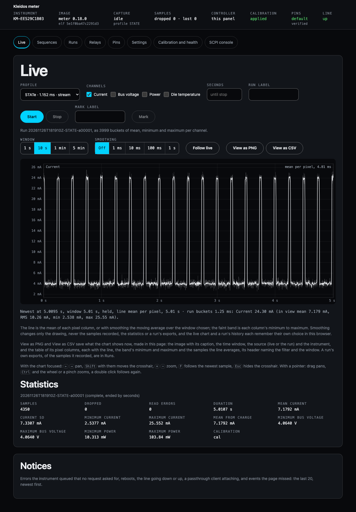

<!-- SPDX-FileCopyrightText: 2026 José M. Requena Plens -->
<!-- SPDX-License-Identifier: GPL-3.0-or-later -->

<!-- BEGIN GENERATED: banner (kleidos-dev/brand, social/tools/sync_readme_banners.py); do not edit by hand -->

<picture>
  <source media="(prefers-color-scheme: dark)" srcset="https://raw.githubusercontent.com/kleidos-dev/brand/main/social/svg/readme/meter/banner-dark.svg">
  <source media="(prefers-color-scheme: light)" srcset="https://raw.githubusercontent.com/kleidos-dev/brand/main/social/svg/readme/meter/banner-light.svg">
  
</picture>

<!-- END GENERATED: banner -->

# The Kleidos bench meter

An ESP32-S3-N16R8 on a DSX063-1 screw-terminal carrier, reading a TI **INA228** current/voltage/power monitor over I²C across an **R100 (0.100 Ω)** shunt, to measure what the nine Kleidos boards draw. It speaks SCPI over its CH343 serial line at 6 Mbps and nothing else: no radio, ever (`docs/architecture.md` §9). A relay pair on the DUT's battery lead takes the offset null without hands.

This repository holds everything the instrument is: its firmware (`firmware/`), its schematic and wiring (`hardware/`), its calibration procedure, records and registry (`calibration/`), its command set (`docs/scpi.md`) and a host client with a simulated instrument and a panel (`host/`). It left the Kleidos firmware repository on 2026-11-19, where it was the nested project `qa/meter/` (`docs/firmware-placement.md` records why it once lived there). The measurements themselves are taken by the Kleidos QA harness (`qa/tools/power_campaign.py` in the firmware repository, which speaks this command set) and filed in that repository's power store; this repository is the instrument.

To measure with it, follow [the usage guide](docs/usage.md), from the command line or [the panel](docs/panel.md) (`kleidos-meter serve`); to build the rig, [the wiring guide](docs/rig-wiring.md). [The index](docs/README.md) lists every document, and [`AGENTS.md`](AGENTS.md) holds the rules for changing this repository.



The panel's Live view on the simulated instrument; every view, in both themes and at a phone's width, is in [the panel's page](docs/panel.md#the-views).

## Quick start

1. **The host client, against the simulated instrument.** No hardware needed:

   ```sh
   python3 -m venv host/.venv
   host/.venv/bin/pip install -e ./host
   . host/.venv/bin/activate
   ```

   ```console
   $ kleidos-meter --sim '*IDN?' 'SYST:ERR:ALL?'
   # the instrument rebooted (*ESR? power-on bit set)
   KLEIDOS,KLEIDOS-METER,KM-EE529C1B03,0.18.0
   0,"No error"
   ```

   `kleidos-meter serve --sim` runs the panel against the same simulator and prints its address ([`docs/panel.md`](docs/panel.md)).

2. **Build** (the toolchain is pinned in `firmware/platformio.ini`: `platformio/espressif32 @ 8.0.0`, ESP-IDF 6.1.1 as the registry's `framework-espidf` 4.60101.0, C++26, every warning an error; the first build installs both):

   ```sh
   source ~/.platformio/penv/bin/activate
   pio run --project-dir firmware -e meter
   ```

   The firmware also builds and runs on the host against a simulated board, with no ESP-IDF toolchain (`make -C firmware/test/native`), and `scripts/run_tests.sh` runs every test of the repository and writes the report (`docs/testing.md`).

3. **Flash**, naming the CH343 port ([Flash](#flash) below), and check the line:

   ```sh
   pio run --project-dir firmware -e meter -t upload    # KLEIDOS_METER_PORT names the port
   ```

   ```console
   $ kleidos-meter '*IDN?' 'SYST:ERR:ALL?' 'ROUT:STAT?'
   # the instrument rebooted (*ESR? power-on bit set)
   KLEIDOS,KLEIDOS-METER,KM-0000000000,0.17.0
   0,"No error"
   k1=lead:closed k2=bypass:open k3=spare:unwired k4=spare:unwired path=shunt check=- pads=ok operate_settle_ms=20 release_settle_ms=50 hold_s=- hold_released=0 bypass_part=relay2click
   ```

   `*IDN?` names the instrument and the version, `SYSTem:ERRor:ALL?` answers `0,"No error"` (or the bring-up's own refusal), and `ROUTe:STATe?` says `path=shunt`: every relay released, the DUT on the shunt.

4. **Before the first number: the calibration registry.** The calibration is the registry in `calibration/`, not the instrument's flash ([`calibration/README.md`](calibration/README.md)). `kleidos-meter calibration verify` holds the instrument's working copy to it, and exits 0 only on `applied`:

   ```console
   $ kleidos-meter calibration verify
   KM-0000000000: applied
     calibration 2026-11-20-02 (mjkdz-r100-relay2click), valid 2026-11-20 to 2027-11-20: range 0 100.116000 mΩ (u 424 ppm), range 1 100.116000 mΩ (u 424 ppm)
   ```

   After a full erase, or the first flash of 0.17.0 or later over an earlier image, it answers `working_copy_lost`, and `kleidos-meter calibration restore` writes the registry's copy back. An instrument the registry does not know yet is calibrated there: the null first, by the one procedure of [`calibration/README.md`](calibration/README.md), "The null, before every measurement session", then `kleidos-meter calibrate`, which walks the shunt's calibration against the 100 Ω reference and files it ("The shunt, two points"). Every session after that starts with a fresh null, the same procedure.

The wiring, with the board in your hand, is [`docs/rig-wiring.md`](docs/rig-wiring.md) and the drawing `hardware/rig.kicad_sch` (rev D, [`hardware/README.md`](hardware/README.md)).

## Flash

The upload must **name the port**. PlatformIO cannot find this board on its own: the `esp32-s3-devkitc-1` JSON this project pins declares the hwid of the **native** USB port (`0x303A/0x1001`), the instrument is used on its **CH343** port (`1a86:55d3`) with the native one unplugged, and every ESP32-S3 Kleidos board on the bench exposes that native hwid. Auto-detection would land on a Kleidos board and flash the meter's firmware onto it.

`firmware/platformio.ini` reads `KLEIDOS_METER_PORT` for both `upload_port` and `monitor_port`; the node name carries the board's serial number, which is private bench data, so it is never written into a tracked file (the Kleidos bench keeps it in its own environment file, which no repository tracks). The pre-upload guard (`firmware/scripts/meter_upload_guard.py`) refuses an upload with no port, a port that is not the CH343 (`1a86:55d3`), and a port whose USB serial is a Kleidos board's in the fleet inventory when that inventory is reachable (`KLEIDOS_FLEET_INVENTORY`, or the firmware checkout beside this one). To find the node, plug only the CH343 cable and ask the USB tree:

```sh
ioreg -p IOUSB -w0 -l | grep -E '"(USB Product Name|idVendor|idProduct|USB Serial Number)"'
# idVendor 6790 (0x1A86) + idProduct 21971 (0x55D3)  -> the CH343 port. Use it.
# idVendor 12346 (0x303A) + idProduct 4097 (0x1001)  -> a native port. Not this.
```

macOS names the CH343 `/dev/cu.usbmodem<serial>1`, because it presents as CDC-ACM; the fleet's CH9102 boards (`1a86:55d4`) appear as `usbserial-…` instead, so the two are told apart in one listing ([`docs/carrier-board.md`](docs/carrier-board.md) §7). Open the port releasing RTS before DTR, or the open itself reboots the board; the host client does (`docs/scpi.md`, "The line").

Upload runs at 460,800 baud and the carrier's two `J3Y` transistors put the chip into download mode from DTR/RTS, so `BOOT` + `RST` by hand is the fallback, not the routine. An app upload writes the bootloader, the partition table and the image and leaves the `calib` and `pins` partitions alone, so the working copy of the calibration survives it; a full erase does not, and `kleidos-meter calibration restore` writes it back (`calibration/README.md`, "The working copy").

## The rig, as wired (rev D, since 2026-11-20)

The INA228 breakout's header lands on the carrier's **left rail**: `VCC` on terminal 1 (3.3 V, **never 5 V**), `SDA` GPIO4 on 4, `SCL` GPIO5 on 5, `ALE` GPIO6 on 6, `GND` on 22. The load goes through its screw terminals, `VIN+` from the cell and `VIN−` towards the DUT, with `VBUS` on the source side of the shunt (`CALibration:VBUSside SOURce` once continuity says so). Every pin and wire, and the checks before power, are in [`docs/rig-wiring.md`](docs/rig-wiring.md).

| Part | Driven by | Left-rail terminal | Role | Released (boot, reset, a dead meter) |
|---|---|---|---|---|
| HW-316 **K1**, an SRD-05VDC-SL-C | `IN1` ← GPIO7, active low | 7 (`VCC` on 21, `GND` on 22) | **the lead**: `COM` on `VIN−`, `NC` to the DUT's battery + | closed: the DUT is on the shunt |
| Relay 2 Click **RL2**, an LCA717 PhotoMOS | its control pin ← GPIO15, active high | 8 (3.3 V on 1, `GND` on 22) | **the bypass**, `k2` on the wire: from `VIN+` to K1 `NC`, around the shunt | open: no bypass |
| HW-316 K2, K3, K4 | `IN2`–`IN4` not wired | GPIO16 and GPIO17 (9, 10) parked | spares, `k3=spare:unwired k4=spare:unwired` | never driven |

The HW-316 is kept for K1 alone, mechanical and closed at rest, so the DUT stays fed with the meter off and no PhotoMOS sits in series with it; its silver contacts could not close the bypass's dry circuit, which moved to the Click on 2026-11-20 ([`docs/relay2-click-wiring.md`](docs/relay2-click-wiring.md), `calibration/records/2026-11-20.md`). One image, `meter`, drives this rig (0.8.0 and later; `meter_relay2` from 0.3.0 to 0.7.0). An image older than 0.8.0 named `meter` drove the HW-316 bypass and must not run here.

## The relays: a null without hands

The two contacts make four circuits, and every relay reply names the one in force as `path=`:

| `path=` | K1 | Bypass | The shunt carries | A capture there |
|---|---|---|---|---|
| `shunt` | closed | open | everything: the measuring circuit, and the boot state | measures |
| `bypass` | open | closed | nothing, with the DUT still running: **the null** | refused unless `INITiate:FORCe`, then `q=invalid` |
| `both` | closed | closed | a fraction | refused unless `INITiate:FORCe`, then `q=invalid`; `CALibration:ZERO` refused outright |
| `none` | open | open | nothing, and the DUT has no battery | measures the zero it draws |

- **The null path.** `ROUTe:NULLpath ON` closes the bypass first and opens K1 second, so the DUT is never without a supply, and reads the shunt before and after each step: the bypass must take current and K1 must leave the shunt dead, or the path is undone and the order refused (`103`, `104`). `check=ok` needs the DUT drawing 2 mA or more; below that the order says `check=unverified`. `ROUTe:NULLpath OFF` recloses K1 before it opens the bypass. A null whose offset comes out beyond 50 µV with K1 commanded open is not stored (`102`). The procedure that uses it is [`calibration/README.md`](calibration/README.md), "The null, before every measurement session".
- **The hold.** Every path but `shunt` is held for at most **120 s** and then put back by the instrument itself, make-before-break, with an error that says which (`113` from `bypass`, `114` from `none`, `115` from `both`), even under a capture, where the moves are marked. A host should still run `ROUTe:NULLpath OFF` in a `finally`. A reset releases every coil at once, as every boot does, and the boot after one that keeps RTC memory says what it released (`116`).
- **The interlocks.** An order that would leave the DUT with no supply (`path=none`) needs `FORCe`; a move while a capture runs needs `LIVE` and is marked in it; one that would take that capture's shunt off the DUT's current needs `FORCe` as well; nothing moves under a running null window. `ROUTe:LEAD:CYCLe <ms>,FORCe` is the timed cold power cycle.

The settle waits are bounds: 20 ms after energizing K1 and 50 ms after releasing it, 10 ms each way for the Click. What the rig measured against them on 2026-11-21, every move well inside its wait, is [`docs/relay-timing.md`](docs/relay-timing.md). Every command, reply and error detail is in [`docs/scpi.md`](docs/scpi.md), "ROUTe: the relay module"; the design, the checks' thresholds and what the relays cannot do are in [`docs/architecture.md`](docs/architecture.md) §6.

## What the instrument measures

Current, voltage, power, energy, charge and the die's temperature, on four profiles chosen per run with `SENSe:PROFile`: `STATE` (1.152 ms a sample) and `SLEEP` (67.52 ms) stream for as long as you like; `TRACE` (280 µs) and `BURST` (100 µs) fill a 4 MiB ring that is read out afterwards. [The usage guide](docs/usage.md#a-first-measurement) says which to take, and [`docs/architecture.md`](docs/architecture.md#32-the-four-profiles) §3.2 why they are these four and what each is worth.

Every report says with `q=` how far to trust it ([the usage guide](docs/usage.md#is-the-number-good-q-path-and-check)). At 0.100 Ω, **10 µA is 1 µV**, exactly the INA228's maximum offset, so the null is the measurement and its residual, about ±0.5 µA, is the instrument's floor ([`docs/architecture.md`](docs/architecture.md#37-the-offset-null-and-the-quality-token) §3.7).

## Layout

```text
.
├── README.md, AGENTS.md, CLAUDE.md, CHANGELOG.md, LICENSE, LICENSES/, NOTICE.md, REUSE.toml, pyproject.toml
├── Doxyfile, Doxyfile.public   # the documentation site and its gate; the site as published (scripts/build_reference.py)
├── sonar-project.properties    # the host package's SonarQube Cloud project, which CI's Sonar job reads
├── docs/
│   ├── README.md, usage.md     # the index and the site's main page; the guide to a measuring session
│   ├── images/panel/           # the panel's views, taken from serve --sim by take_panel_shots.py
│   ├── panel.md, http-api.md   # the panel on the PC; its HTTP API (generated by gen_http_api_doc.py)
│   ├── cli.md, python-api.md   # the command line; the host package (generated by gen_cli_doc.py, gen_python_api_doc.py)
│   ├── scpi.md                 # the protocol, and its quick reference
│   ├── troubleshooting.md      # a symptom, its cause, the check and the fix
│   ├── architecture.md         # the firmware's design, kept current
│   ├── testing.md, misra.md    # the tests and the report; the MISRA register
│   ├── rig-wiring.md, relay2-click-wiring.md, relay-timing.md  # the rig, the bypass, the relays' times
│   ├── ina228-reference.md, carrier-board.md  # the sensor and the board
│   ├── firmware-design.md      # the record of the 0.1.0 design
│   ├── firmware.dox, groups.dox  # the firmware reference's front page and topics (Doxygen)
│   └── published-reference/    # header.html, footer.html, layout.xml: the API host's design for the published site
├── firmware/
│   ├── platformio.ini          # [env:meter], the one image; the toolchain pins and the warnings as errors
│   ├── CMakeLists.txt          # project( kleidos-meter ), the components it builds, the link wraps
│   ├── sdkconfig.defaults      # every option with its reason
│   ├── board/pins.toml         # the carrier board, pin by pin: the source of pin_table.h and the panel's copy
│   ├── partitions.csv          # the calib and pins partitions and the image
│   ├── version.txt             # the instrument's version
│   ├── scripts/                # meter_upload_guard.py, meter_version_reconfigure.py
│   ├── test/native/            # the host tests and their fake ESP-IDF
│   └── src/
│       ├── CMakeLists.txt      # the component: its sources and the requirements, each with its reason
│       ├── main.cpp            # app_main(): read the pin map, release the relays, blank the LED, bring up, run the console
│       ├── relay.h/.cpp        # the lead and the bypass, the four circuits, the planned orders, the hold, the parked pins
│       ├── pinmap.h, pin_table.h  # the pin map's rules and defaults; the board's pins, generated (scripts/gen_pin_table.py)
│       ├── pin_boot.h/.cpp     # the map the boot runs: loaded, its bus brought up, the fallback
│       ├── pin_apply.h/.cpp    # the move to another map and back: relays, ALERT, bus
│       ├── pinmap_store.h/.cpp # the pin map's record in its own log, the store's judgment of one
│       ├── status_led.h/.cpp   # the RGB LED blanked on the RMT's registers
│       ├── ina228_regs.h       # the INA228's register map
│       ├── ina228.h/.cpp       # bring-up, identity, the transactions on the bus's core
│       ├── i2c_bus.h/.cpp      # I2C0 on its registers, polled, nothing allocated
│       ├── sampler.h/.cpp      # the profiles, the pacing, the ring, the anchors, the statistics, the null
│       ├── scale.h, calmath.h, wide.h  # the integer conversions, the shunt calibration's arithmetic, 128-bit sums
│       ├── calibration.h/.cpp  # the calibration's record and the quality token
│       ├── flash_log.h/.cpp    # the append-only record logs, two sectors of raw flash each
│       ├── flash_port.h/.cpp   # the logs' places, their port on esp_flash, the static region check
│       ├── console.h/.cpp, console_commands.cpp  # the command table and the handlers
│       ├── scpi.h/.cpp         # the SCPI parser, the error queue, the status registers
│       ├── text.h/.cpp         # the bounded writer every response is composed with
│       ├── bits.h, chars.h     # register fields on std::uint32_t; character classes from a table
│       ├── uart0.h/.cpp        # the console's UART0 on its registers
│       ├── interrupt.h/.cpp    # the ALERT pin's and UART0's interrupts routed with nothing allocated
│       ├── watchdog.h/.cpp     # the instrument's own watchdog on Timer Group 0
│       ├── brownout.h/.cpp     # the brownout detector, armed by the firmware
│       ├── startup_memory.h/.cpp  # static answers to ESP-IDF's startup allocations
│       ├── heap_monitor.h/.cpp # the heap hooks behind DIAGnostic:HEAP?
│       ├── rtos_ticks.h        # milliseconds to FreeRTOS ticks
│       ├── identity.h/.cpp, sha256.h  # the instrument serial
│       └── crc32.h             # the dump's and the record log's CRC-32
├── host/                       # kleidos_meter: the client, the simulator, the CLI, the panel, their tests
├── calibration/                # the registry, the records and the procedure
├── hardware/                   # the schematic (generated by gen_rig.py), its renders, the BOM
├── scripts/                    # the test, analysis, census, gate and document-generator scripts
└── tests/                      # host tests over the sources, the CI configuration and the bench suite
```

`tests/firmware/test_readme.py` fails when a file of `firmware/src`, a page of `docs/` or a top-level entry of the repository is missing from this block, and when it names a file the tree does not hold.

## Still open, for the bench

1. Which LED pin it was: the image blanks both candidates, GPIO48 and GPIO38 (`SYSTem:LED?`, `docs/architecture.md` §8).
2. ~~The real I²C address, from the boot scan.~~ Settled on 2026-11-21: `0x40`, alone, in 20 scans of 0.16.5's bench acceptance ([`CHANGELOG.md`](CHANGELOG.md#0165-2026-11-21), 0.16.5).
3. The value of the three `01C` resistors, and so whether 400 kHz is clean with longer wiring. On the short wiring of the rig, `BURST` at 1 MHz runs with `read_err=0` (`docs/architecture.md` §2.1).
4. Whether `VBUS` is tied internally to either side of the shunt (`docs/rig-wiring.md` §1.3).
5. Whether `CHARGE` accumulates at 10 µA or truncates to zero: a known 10 µA load for 60 s should give `ΔCHARGE ≈ 192` counts in range 0. No number the protocol reports depends on it, and every capture reports the accumulator at both its boundaries (`docs/architecture.md` §11.1).
6. ~~The real shunt resistance and its tolerance.~~ Settled on 2026-11-20: R = 100.116 mΩ ± 0.085 mΩ (k = 2), against the VPG 100 Ω reference on both ADC ranges, event `2026-11-20-02` of `KM-0000000000` ([`calibration/records/2026-11-20.md`](calibration/records/2026-11-20.md), §4 to §7).
7. ~~Whether the `ALE` pin pulses per conversion or is level-held.~~ Settled on 2026-11-20: it is held low from a conversion's end until `DIAG_ALRT` is read, in either `ALATCH` mode; from 0.9.0 `STATE` and `SLEEP` pace on it and report `pace=` ([`docs/architecture.md`](docs/architecture.md#33-pacing) §3.3, the bench table).
8. Whether `DIAG_ALRT` bit 0 `MEMSTAT` latches what is written to it. The pacing word writes a 1 back; 200 rounds of `DIAGnostic:ALERt?` on 2026-11-21 read `memstat=1`, which does not tell a latch from a read-only bit. The answer belongs beside the register table in `docs/ina228-reference.md`.
9. Whether every relay stays released through a meter power-up and a reset, before `app_main()` drives the pins: the ESP32-S3 datasheet (Table 2-2) gives GPIO7 a 60 µs low glitch at power-up, far shorter than a coil needs. The first-power check of `docs/rig-wiring.md` §8.5 settles it.
10. ~~Whether the settle times hold.~~ Settled on 2026-11-21 and 2026-11-20: with a 100 Ω load, K1 opened in 1.96 to 2.52 ms and reclosed in 11.20 ms, and the Click's RL2 turned on in 0.56 to 1.12 ms and off in 0.56 to 0.84 ms, every move inside its wait ([`docs/relay-timing.md`](docs/relay-timing.md)); and the hand null came out 0.057 µV from the relay null, inside the 0.1 µV criterion ([`calibration/records/2026-11-20.md`](calibration/records/2026-11-20.md), §2).
11. Whether terminal 21 holds 5 V under K1's coil, measured loaded (`docs/rig-wiring.md` §8.5 step 1). Unloaded it read 4.9 V on 2026-10-30 with `IN-OUT` bridged (`docs/carrier-board.md` §6), and K1 opened and reclosed on every measured move of the 2026-11-21 timing runs; the loaded reading is not on record.
12. Whether the INA228's input bias current matters at microamp levels. The two-point procedure that would have shown it (two loads three decades apart) was superseded on 2026-11-20 by the calibration on both ranges at one current, which cannot; a known 10 µA load read against the calibrated shunt would.
