<!-- SPDX-FileCopyrightText: 2026 José M. Requena Plens -->
<!-- SPDX-License-Identifier: GPL-3.0-or-later -->

# The panel

`kleidos-meter serve` holds the meter's port and serves a panel on this computer: live charts, one button per measurement sequence, the relays, the pin map, the settings with each range's shunt and its uncertainty, the recorded runs, and an HTTP API underneath. The meter has no radio and no web page of its own; the panel reaches it over the cable. A measuring session from the command line is in [usage.md](usage.md), and every route of the API in [http-api.md](http-api.md).

> **The panel is unauthenticated, and listens on the loopback only.** Whoever reaches its address can move the relays, start captures and change the settings, so `serve` binds 127.0.0.1 and refuses any other address unless `--allow-remote` says otherwise. What it guards against is accidents: another web page in the same browser, a GET that would change something. It does not guard against a person at this machine. Do not forward its port.

Two kinds of example are on this page. The ones with `--sim`, and every `curl`, were run against the simulated instrument, and a test runs them again and compares what they print (`host/tests/test_panel_doc.py`). The others were run on the bench on 2026-11-24, instrument `KM-0000000000` on firmware 0.17.0, with a T-Deck asleep on its battery as the board under test (the DUT).

## Contents

- [Start it](#start-it)
- [The views](#the-views)
- [On the bench](#on-the-bench)
- [The chart](#the-chart)
- [The pin view](#the-pin-view)
- [Noise reduction in the INA228](#noise-reduction-in-the-ina228)
- [What each sequence moves](#what-each-sequence-moves)
- [Recordings and exports](#recordings-and-exports)
- [The SCPI passthrough](#the-scpi-passthrough)
- [From a script](#from-a-script)
- [Stop it, and what it hands back](#stop-it-and-what-it-hands-back)
- [When something dies](#when-something-dies)
- [Which route is behind what](#which-route-is-behind-what)

## Start it

Install the host tool and name the port first ([usage.md](usage.md#install-the-host-tool)). On the simulator, with nothing plugged in:

```console
$ kleidos-meter serve --sim
serve: KM-EE529C1B03, firmware 0.18.0, image meter, elf 5e1f0ba47c2291d3, q=cal
serve: reset poweron, up 1.1 s
serve: panel at http://127.0.0.1:8040/
serve: panel API at http://127.0.0.1:8040/api/
serve: recordings in ~/.local/state/kleidos-meter/runs
serve: holding the port; stop with Ctrl-C
serve: released the port
```

On the meter, with a passthrough for another tool:

```console
$ kleidos-meter serve --scpi-passthrough
serve: KM-0000000000, firmware 0.17.0, image meter, elf 0f2b6ed8b28068a4, q=cal
serve: reset poweron, up 2235.0 s
serve: panel at http://127.0.0.1:8040/
serve: panel API at http://127.0.0.1:8040/api/
serve: SCPI passthrough at socket://127.0.0.1:5025
serve: recordings in ~/.local/state/kleidos-meter/runs
serve: holding the port; stop with Ctrl-C
```

Open the panel's address in a browser. Nothing is loaded from elsewhere, so it works with no network.

| Option | What it does | By default |
|---|---|---|
| `--port` | the meter's port | `KLEIDOS_METER_PORT` |
| `--sim` | serve the simulated instrument instead: its samples flow in real time, and nothing it says is a measurement | off |
| `--sim-wiring` | with `--sim`, where the simulated board's parts are, `key=value` pairs over the rig's (`sda=18,addr=0x41`): a pin map applied on other pads finds no INA228 and is reverted | the rig |
| `--http` | the panel's TCP port; `0` takes any free one, and the address is printed | 8040 |
| `--bind`, `--allow-remote` | listen on another address. Beyond the loopback `--bind` alone is refused, and with `--allow-remote` serve warns | 127.0.0.1 |
| `--data-dir` | where runs are recorded; a directory inside a git work tree is refused | `$XDG_STATE_HOME/kleidos-meter/runs`, or `~/.local/state/kleidos-meter/runs` |
| `--registry` | the calibration registry each range's shunt is shown against | this checkout's `calibration/` |
| `--elf` | the build the instrument's `elf=` is compared with | this checkout's `meter` build |
| `--scpi-passthrough [PORT]` | lend the line to one SCPI client at a time ([below](#the-scpi-passthrough)) | off; port 5025 |
| `--ready-timeout` | how long to wait for the instrument to answer, seconds | 15 |

**`serve` is the one opener of the port while it runs.** It opens it exclusively, so a second `serve`, `kleidos-meter capture` and a Kleidos QA run are refused at once, and told who holds it:

```console
$ kleidos-meter capture --profile STATE --seconds 1
# the port is held by kleidos-meter serve (pid 14370, since 2026-11-24T06:23:13+01:00, panel http://127.0.0.1:8040/, passthrough socket://127.0.0.1:5025)
```

`MeterLink`, the Kleidos harness's client, opens the port itself and cannot use the passthrough: stop `serve` before a QA run.

On start it reads what the instrument is, its health and what it had queued, and takes a snapshot of every setting that shapes a capture. A capture or a null window somebody else left open is reported and left alone. It exits 0 after a clean stop; 1 when the port is held, an address cannot be bound, the instrument does not answer or the settings could not be written back; 2 for a usage error.

## The views

The images on this page were taken from `kleidos-meter serve --sim` by `scripts/take_panel_shots.py`, in a fixed scenario: a simulated DUT that draws a stepped current under noise, one recorded run, the `HEALTH` sequence done. Nothing they show is a measurement. Each view is shown dark at a desktop's width, with the light theme and a phone's width (390 px) linked under it, and `tests/firmware/test_panel_images.py` names the image to take again when a view changes.

The status bar stays in view from a tablet's width up (720 pixels): the instrument and its image, the capture, the samples the instrument `dropped` and those the page `lost` (and, while it is on, the INA228's [noise reduction](#noise-reduction-in-the-ina228)), who controls the line, the registry's verdict on the calibration, the pin map and whether its relays are verified, and the line itself. Each item holds a label, a value and a qualifier under it (`not quotable`, the image's `elf=`, the profile), one line each, so the bar keeps one height on every view at a given width; a value its column cuts short is whole in its hover text. Whatever the page scrolls to, a pin moved to with the arrow keys or a view's link, stops below the bar. On a phone the bar, its cells stacked, would take a third of the screen, so it scrolls away with the page. Below it, one view at a time.

What serve or the instrument refuses is shown beside the control that sent it, with its HTTP status and the instrument's error codes ([scpi.md](scpi.md)). The notices list, under every view, keeps the last 20 events nobody asked for: device errors, a reboot, the line going down, a passthrough client, samples missed. A device error is what the instrument queued on its own (a hold that released a relay, `113` to `115`; relays a reset released, `116`; a message an overrun discarded, `-363`): whichever request's message drains it, it is shown here and kept in the running capture's errors, never as that request's refusal.

### Live

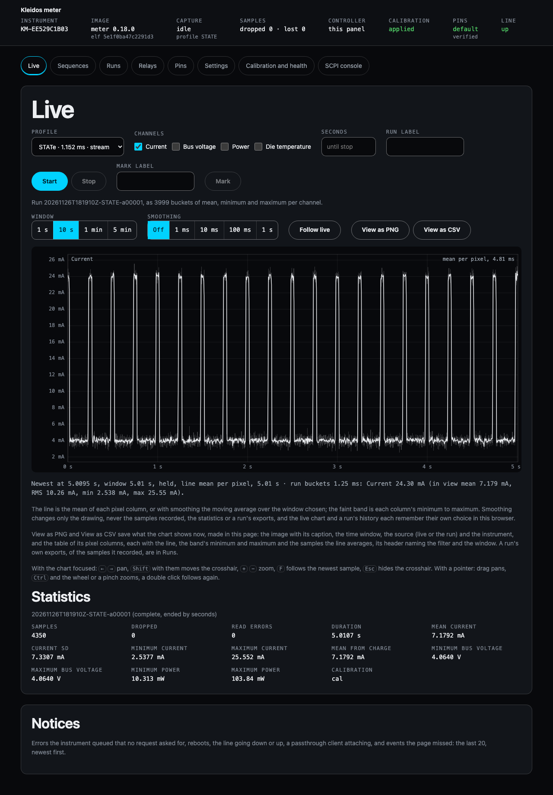

The same view in the [light theme](images/panel/live-light-1280.png) and at a [phone's width](images/panel/live-dark-390.png).

Choose a profile, its channels, a length and a label; Start, Stop, Mark. The chart follows the newest sample until you zoom or pan (Follow live, or `F`, goes back); what its line and its band are, and what smoothing does, is [the chart](#the-chart). A run's label is printable ASCII, at most 80 characters, and a mark's 1 to 15 with no space and none of `,` `;` `=` `"` `'`: the fields take no more, by the limits `/api/schema` declares. The text readout under the chart is announced to a screen reader when you pan, zoom or point at the chart, not each second as it follows a capture. A ring profile streams nothing: the view shows its fill, and draws the run when it ends. After a capture, its statistics.

### Sequences

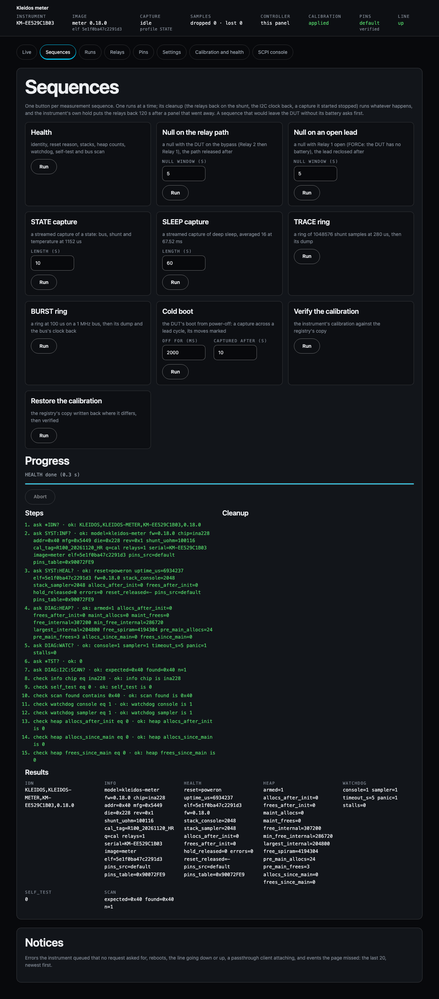

The same view in the [light theme](images/panel/sequences-light-1280.png) and at a [phone's width](images/panel/sequences-dark-390.png).

One card per sequence with its parameters and a Run button; the steps, the cleanup and the results as they come, Abort, and a sequence's question in a dialog whose safe answer has the focus. What each one moves is [What each sequence moves](#what-each-sequence-moves).

### Runs

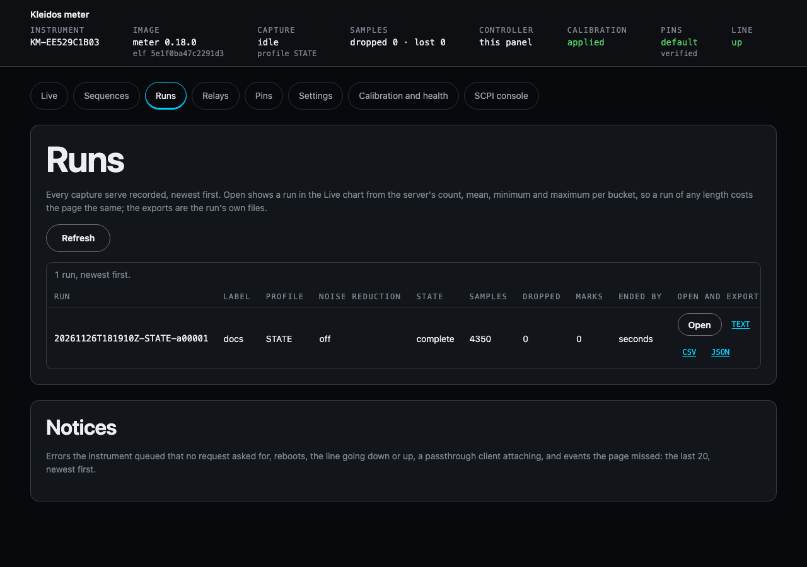

The same view in the [light theme](images/panel/runs-light-1280.png) and at a [phone's width](images/panel/runs-dark-390.png).

The latest 100 runs, those taken with noise reduction marked: Open draws one in the Live chart, and each downloads as `text`, `csv` or `json` once it has ended (the run serve is still recording has no export yet: one is made once and kept). What each export holds is [Recordings and exports](#recordings-and-exports).

### Relays

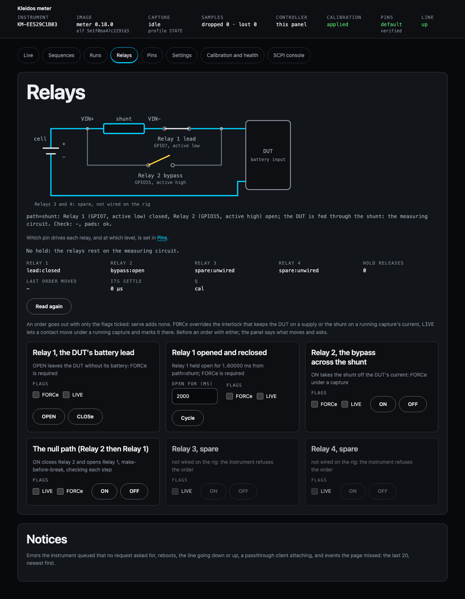

The same view in the [light theme](images/panel/relays-light-1280.png) and at a [phone's width](images/panel/relays-dark-390.png).

The circuit as it is, the wires that carry the DUT's current marked, the hold's countdown, and one card per order. Relay 1 is the DUT's battery lead and Relay 2 the shunt bypass. An order goes out with only the flags you tick, and one with `FORCe` or `LIVE` asks first, naming what moves.

### Pins

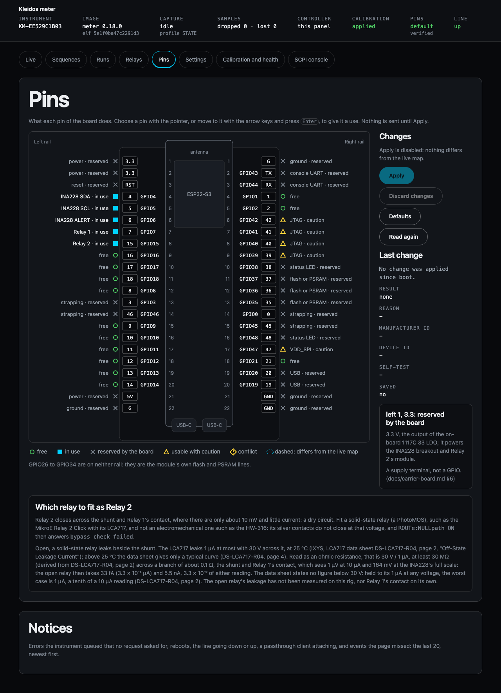

The same view in the [light theme](images/panel/pins-light-1280.png) and at a [phone's width](images/panel/pins-dark-390.png).

The board, pin by pin: each pin's state in color, shape and word, and what it is and why beside it. Choose a pin (or move to it with the arrows and press Enter) to give it a use and its configuration; conflicts are drawn and named, and nothing is sent until Apply, which asks first. The result says whether the change was kept or reverted, and why. What each mark means, and how a change is applied, proved and undone, is [the pin view](#the-pin-view).

### Settings

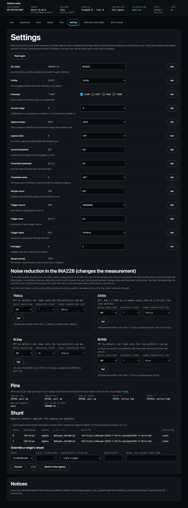

The same view in the [light theme](images/panel/settings-light-1280.png) and at a [phone's width](images/panel/settings-dark-390.png).

Every setting with the instrument's answer, written one at a time and read back; a control the instrument would refuse now is disabled and says why. Below them, the INA228's [noise reduction](#noise-reduction-in-the-ina228) of each profile, what the pin map gives each role, and each range's shunt.

#### The shunt and its uncertainty

Settings shows, per range, the value the instrument converts with and where it came from (`registry`, `override`, `nominal` or `device`), beside the registry's figure with `U` at `k = 2`. For `KM-0000000000` both ranges read 100116 µΩ, `registry`, U = 848 ppm (±84.898 µΩ).

An **override** (a shunt swapped on the bench, a datasheet's figure) is taken only with its uncertainty, stated exactly once: `U` at `k = 2`, in ppm or micro-ohms, or a tolerance, a rectangular limit. It is previewed first, and written only from the preview after you confirm it. While a range converts with one, the panel says **Not quotable**, and the only way back is Revert to the registry, which writes the registry's copy and removes the override. An override is kept on this computer (`$XDG_STATE_HOME/kleidos-meter/overrides/<serial>.json` by default, beside the data directory), never in the repository.

### Calibration and health

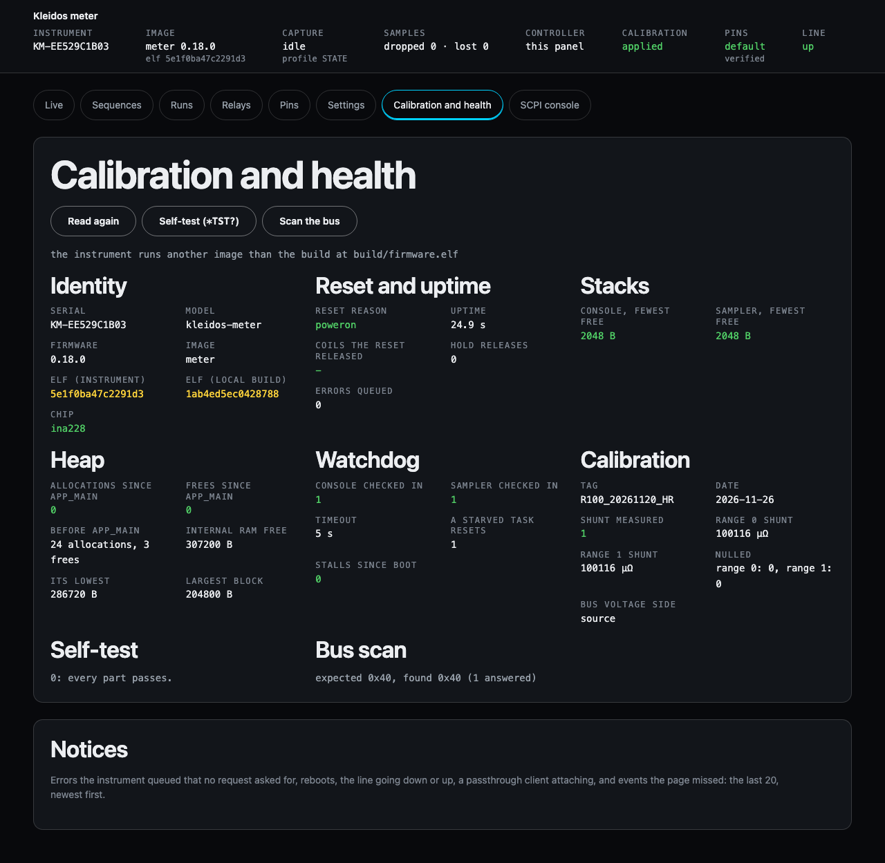

The same view in the [light theme](images/panel/health-light-1280.png) and at a [phone's width](images/panel/health-dark-390.png).

Identity and the build's `elf=`, the last reset, the stacks, the heap counts, the watchdog, the calibration; on request the self-test and the bus scan. The local build the instrument's `elf=` is compared with is named relative to serve's working directory or this repository, else by its last two parts, never by an absolute path of this computer.

### SCPI console

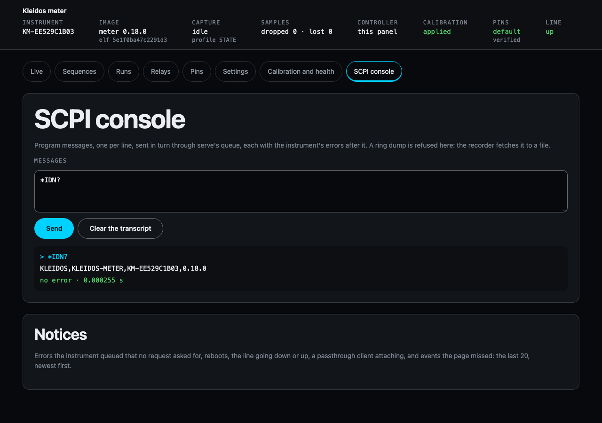

The same view in the [light theme](images/panel/console-light-1280.png) and at a [phone's width](images/panel/console-dark-390.png).

Any program message, one per line, with its answers and errors in a transcript. The lines run in order; if one after the first times out, finds the queue full or the line down, the ones before it stay in the transcript (they ran), the one that failed says why, and the console names how many were not sent: send those again, not the whole text.

## On the bench

The images above are the simulator's. These four are the panel over the cable to the meter, taken by its bench test (`host/tests/test_panel_bench.py --run-bench --bench-shots`, headless Chromium, the light theme, 1280 px wide, the whole page) in 0.18.0's run of record ([misra.md](misra.md#the-run-of-record-0180)): instrument `KM-0000000000` on firmware 0.18.0, the rig of `hardware/rig.kicad_sch` rev D, a T-Deck asleep drawing about 43 µA through the shunt. Their figures are that instrument's, on that day; nothing retakes them when a view changes, and `docs/images/panel/manifest.json` lists each as `kind` `bench` with its date, its `elf=`, the ELF's SHA-256, the commit it was built from and the SHA-256 of the file (`scripts/file_bench_shots.py` files them, and `tests/firmware/test_panel_images.py` holds the entries). Each was looked at for a port name, a USB serial, a MAC address or a path before it was filed: there is none. The instrument's serial is shown as the placeholder `KM-0000000000`, redrawn over the real one in the header and the Identity panel ([the calibration's README](../calibration/README.md#the-registry), "Identity"); nothing else in them was touched.

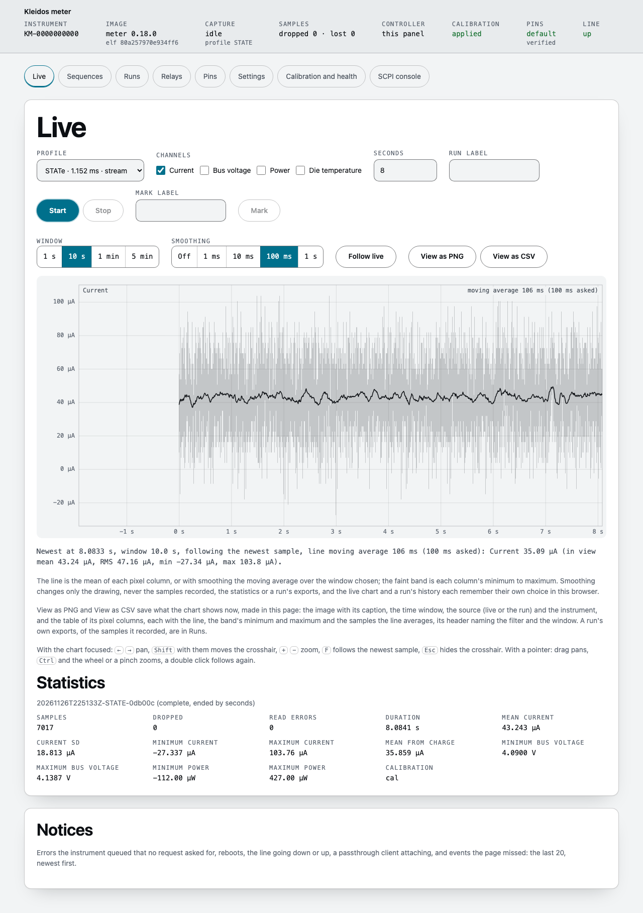

A bench image, 2026-11-26, `elf=80a257970e934ff6`: the Live view after an 8 s `STATE` capture at 100 ms of smoothing. The readout's mean in view, 43.24 µA, is the capture's: `FETCh:STATistics?` answered `mean_na=43242.86`.

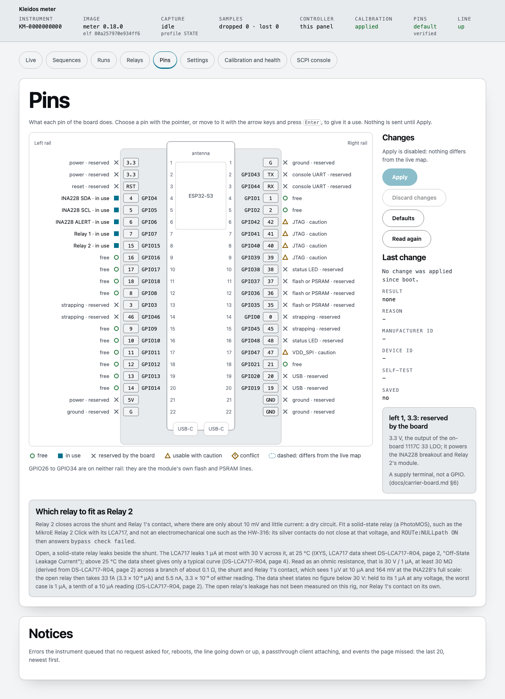

A bench image, 2026-11-26, `elf=80a257970e934ff6`: the Pins view drawing the map the instrument reported (`src=default`, verified), before the apply below.

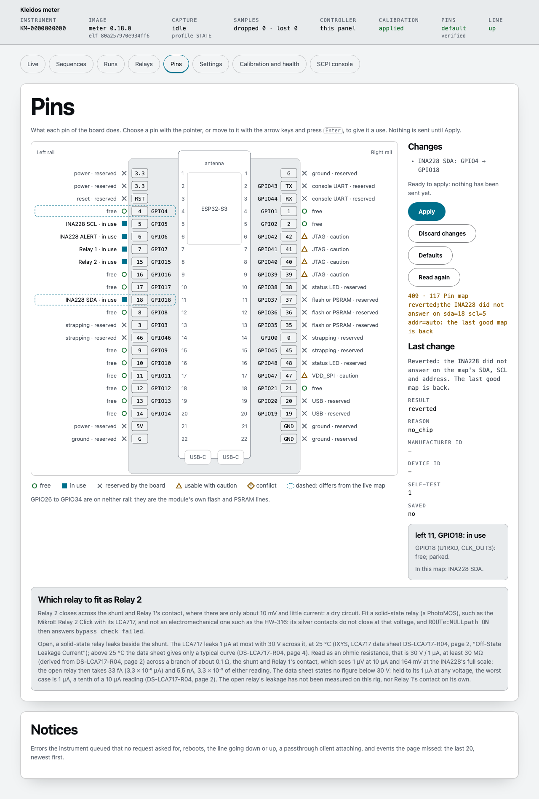

A bench image, 2026-11-26, `elf=80a257970e934ff6`: SDA moved to GPIO18 and applied from the page; the instrument found no INA228 there, put the last good map back by itself and queued one `117`, which the page shows beside Apply and under Last change.


A bench image, 2026-11-26, `elf=80a257970e934ff6`: the Calibration and health view after the self-test (`0: every part passes.`). The local build is the one flashed, so its ELF matches the instrument's, and the page names it relative to the project, `firmware/.pio/build/meter/firmware.elf`. The reset reads `task_wdt` because the suite's watchdog test had forced one on that boot.

## The chart

The Live chart draws one lane per unit of the channels the capture streams, on a shared time axis, and a run opened from Runs the same way.

- **The line is the arithmetic mean** of the samples in each pixel column: every sample counts, once. **The faint band** behind it is each column's minimum to maximum, so a spike shorter than a column, which the mean flattens, is still drawn. The caption at the top right of the plot says what the line is, `mean per pixel, 4.81 ms` in the image below, where a 5 s run spans the plot and a column holds 4.81 ms of it.
- **Why the mean.** What a DUT takes from its battery is charge, the integral of its current, and the mean current over a stretch times its length is that charge. A line of one sample per column, or of each column's median, would draw a level the battery never paid; an envelope alone would show the extremes and hide the level. The INA228's own averaging and the run's statistics are means too, so all three read alike.
- **Smoothing** (Off, 1 ms, 10 ms, 100 ms, 1 s; one choice per chart, the live chart's and a run's history's each remembered in this browser) makes the line a centered moving average: at each column, the mean of every sample within half the window of it. The window is the odd number of whole columns nearest to the choice and never less than one, and the caption names the window drawn, with the choice beside it when the two differ (`moving average 101 ms (100 ms asked)`). A window is never longer than twice the view: zoomed to 1 ms, 1 s of smoothing draws a 2 ms window and says so (`moving average 2 ms (1 s asked)`), since a longer one would only flatten the line and cost the page its memory. A centered moving average is chosen over a one-pole low-pass because each point is then a figure that can be quoted ("the mean current over 100 ms"), it puts a peak at its own time with no lag, and it forgets in exactly one window, where a one-pole is still 37 % away after one time constant. Across a gap wider than the window the line breaks.
- **A run's history is its buckets.** Open in Runs fetches the run decimated into at most 4000 buckets, each the mean of its samples with their minimum and maximum, and the chart draws those: the bucket is the finest the line can show, so the caption names it (`run buckets 900 ms` for an hour) and a zoom stops at one bucket per pixel column. Each column takes the share of a bucket's samples its span covers, so the readout's `n` can be fractional, and its minimum and maximum in view are those of every bucket the view touches, whole: a spike in a bucket that only begins inside the view counts though it may lie outside it.
- **The readout** under the chart says the newest sample's time, the window, whether the chart follows, what the line is, and for each channel the newest value with the mean, RMS, minimum and maximum of the samples in view, which smoothing never changes. With the crosshair (point at the chart, or `Shift` and the arrows) it says the line's value at that column and the column's minimum to maximum instead of the newest value. The 100 ms image below reads `Newest at 5.0107 s, window 5.01 s, held, line moving average 101 ms (100 ms asked): Current 23.28 mA (in view mean 7.267 mA, RMS 10.38 mA, min 2.606 mA, max 25.29 mA).`
- **View as PNG and View as CSV** save what the chart shows now, made in the page. The PNG carries the caption, the time window, the source (live or the run) and the instrument, as drawn and as text chunks. The CSV starts with `# key=value` lines, `filter` (`mean per pixel column` or `moving average`), `caption`, `asked_ms`, `window_ms`, `column_ms`, the noise reduction, `source`, `instrument`, the time window and the units, `source_resolution` and `bucket_us` (`every sample`, or a run's buckets and their width), then one row per pixel column and channel: `t_us`, `mean` (the line), `min` and `max` (the band) and `n` (the samples the line's value averages).
- **What a frame costs.** The chart is drawn at most 30 times a second, and never sooner after a frame than twice the time that frame took, so drawing a full ring (5 min of `STATE`'s four channels, 262,144 samples, reduced in one pass over the samples for every lane) never takes more than half the page's time; a chart held on an earlier stretch is not drawn again for samples that land past it.
- **Recorded data is never altered.** Smoothing changes the drawing alone: never the samples recorded, the run's `stream.txt`, its statistics, or its exports from Runs, which hold the samples as the instrument sent them. It is not sent to the instrument and not kept in the run.

What each choice does to a step, a current that jumps from one level to another and stays there:

| Choice | The line at the step | A pulse shorter than the window |
|---|---|---|
| Off | rises within one column, the mean of the column the step falls in | drawn at its own height when it fills a column, lower when it fills part of one; the band keeps its peak |
| 1 ms | the same as Off when a column is wider than 1 ms (the caption then says `(1 ms asked)`); else a straight ramp 1 ms long, centered on the step | spread to its width plus 1 ms, at its height times its length over 1 ms |
| 10 ms | a straight ramp 10 ms long, half before the step and half after, crossing half the step at the step itself | spread to its width plus 10 ms, at its height times its length over 10 ms |
| 100 ms | a ramp 100 ms long, the same way | the same rule: in the image below, pulses some 20 mA above a 4 mA floor are drawn near 12 mA, and the band still reaches 25 mA |
| 1 s | a ramp 1 s long | a train of pulses whose period is under 1 s becomes a flat line at the train's mean current, the figure a battery estimate is made of |

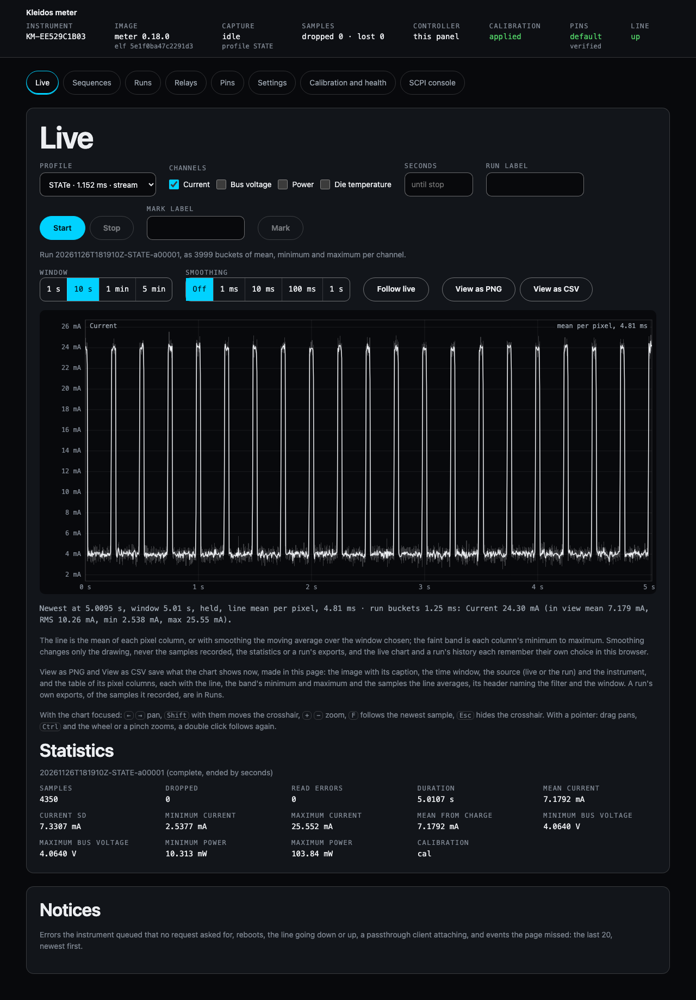

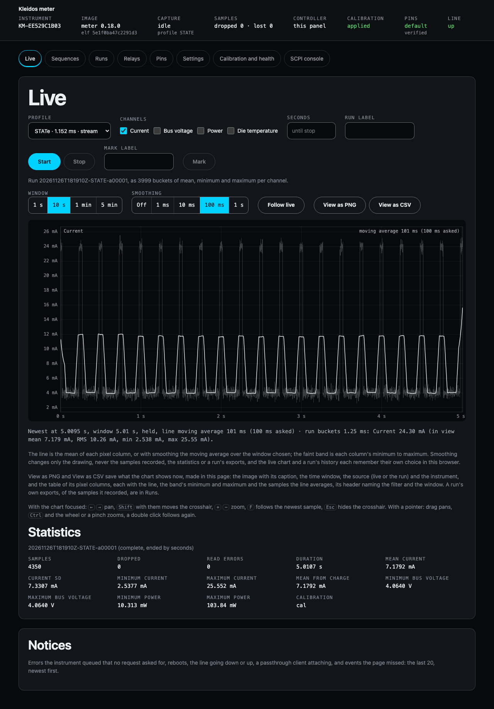

## The pin view

The board drawn is the meter's devkit, the YD-ESP32-S3 on its DSX063-1 carrier, with both rails in their real order and their silk numbers; its source is `firmware/board/pins.toml`, the same table the firmware validates a map with, generated into the panel's copy so the two cannot disagree ([carrier-board.md](carrier-board.md)). Each pin is marked in color, shape and word, so no mark depends on color alone, and the pin under the pointer or the focus is described in the box beside the drawing, what the pin is and why it has its state. On a wide screen the box stays in view below the status bar as the page moves down the rails; on a narrow one it comes after the drawing, and a pin's dialog (a tap, or Enter) says the same at its top:

| Mark | State | What it means on this board |
|---|---|---|
| green ring | **free** | nothing on the chip or the board claims it: any role may take it |
| filled square, in the accent | **in use** | a role of the map shown takes it: INA228 SDA, SCL or ALERT, Relay 1 or Relay 2. "in use, with caution" on a caution pin |
| gray cross | **reserved by the board** | the strapping pins (GPIO0, GPIO3, GPIO45, GPIO46), the module's flash and PSRAM lines (GPIO26 to GPIO37; GPIO26 to GPIO34 are on neither rail), the native USB pair (GPIO19, GPIO20), the console's UART to the CH343 (GPIO43, GPIO44), the status LED's lines (GPIO38, GPIO48), and the supply, ground and reset terminals. No role may take one |
| amber triangle | **usable with caution** | the JTAG pads (GPIO39 to GPIO42: taking one costs an external JTAG probe) and GPIO47, in the VDD_SPI power domain |
| amber diamond | **conflict** | the draft breaks a rule at this pin: two roles on one pin, a role on a reserved pin, ALERT at GPIO32 or above, a role left with no pin. The rule is named on the pin and in the list beside the drawing |
| dashed outline | changed | the pin's use differs from the map the instrument runs |

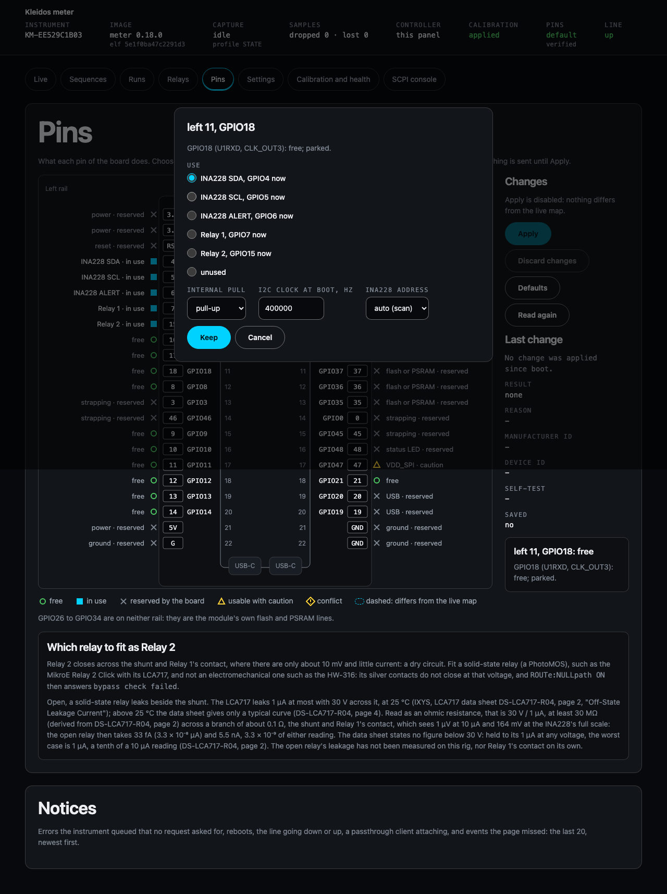

**Choosing a use.** A pin's dialog offers the five roles, each with the pin it holds now, and unused. A bus pin takes its internal pull, the I²C clock at boot (50 kHz to 1 MHz) and the INA228's address (`auto`, a scan at boot, or 0x40 to 0x4F); ALERT takes its pull; a relay pin takes the level that energizes its relay. Keep puts the choice in the page's draft, and nothing else: the instrument has not heard of it.

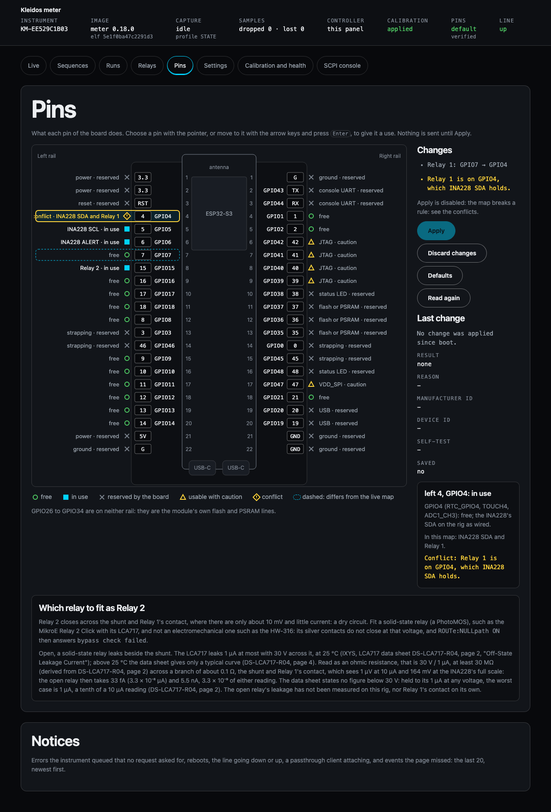

**Applying it.** The page judges the draft by the firmware's rules as you go, lists what differs from the live map, and keeps Apply disabled while a conflict stands or nothing differs. Apply asks first, then stages the draft on the instrument (`POST /api/pins/stage`) and applies it (`POST /api/pins/apply`, `SYST:PINS:APPL`). The instrument refuses it, and nothing moves, while a capture or a null window is open or the relays are not at rest on the shunt. Otherwise it moves the relays to their new pins at their released level, parks the pins no role holds any more, opens the bus on its new pins and brings the INA228 up there.

**How it is proved.** The map is kept only if the INA228 answers on it: its address, its manufacturer and device ID registers, its reset values, and `*TST?`, the ALERT wire and the relay pads included. A map that passes is saved and is the live one. One that fails is undone by the instrument itself: the last good map comes back, proved the same way, one error `117` is queued, and the view says `reverted` with the reason (`no_chip`: nothing answered on the map's bus; `chip`, `alert`, `pads`, `save`, `rest`, ...), as `SYST:PINS:RES?` reports it. When a relay's pin or level changed, the null-path check runs after the apply (Relay 2 closes and Relay 1 opens for a moment, and both go back): the relays are verified again only once it passes, which needs a DUT that draws 2 mA or more. Under 2 mA the instrument cannot see a contact move (`check=unverified`), so Relay 1 opens whether Relay 2 closed or not: a Relay 2 moved to a pin it is not wired to leaves the DUT without its battery for that moment. With such a DUT, move Relay 2 only to the pin it is wired to.

**A wrong active level acts at rest.** A relay given the level that energizes its part is energized whenever the instrument means it released: Relay 1 then cuts the DUT's battery and Relay 2 bypasses the shunt, at rest, while `path=shunt` is reported, and again after every reboot once the map is saved. With a DUT that draws 2 mA or more the instrument reads the shunt before and after the move and puts the last good map back by itself (`reverted`, reason `rest`, one `117`); the DUT is without its battery, or its shunt, only while the map is tried. Under 2 mA it cannot tell, the map is kept and saved, and Defaults is the way back. Apply's confirmation says so whenever a relay's pin or level changes.

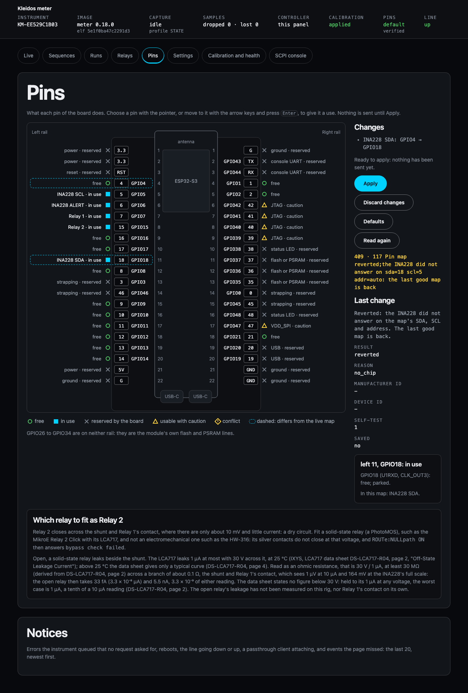

**Back to the defaults.** Defaults in the view applies the default map (SDA GPIO4, SCL GPIO5, ALERT GPIO6, Relay 1 GPIO7 active low, Relay 2 GPIO15 active high, the address scanned, 400 kHz), with Apply's checks; it is kept whatever its proof finds. When the panel cannot help (the page will not load, or a map left the instrument with no INA228), the console can, and needs no I²C: no map may take GPIO43 or GPIO44, the console's UART to the CH343. Stop `serve` (or come in through its passthrough, `--port socket://127.0.0.1:5025`), close what is open (`ABOR`, and `ROUT:NULL OFF` for a relay off its rest), and send `SYST:PINS:DEF` on the meter's port. On the simulator, which prints what the meter does:

```console
$ kleidos-meter --sim 'SYST:PINS:DEF;:SYST:PINS:RES?' 'SYST:PINS?' 'SYST:ERR:ALL?'
# the instrument rebooted (*ESR? power-on bit set)
result=ok reason=- mfg=0x5449 die=0x228 tst=0 saved=1
sda=4 scl=5 alert=6 addr=auto scl_hz=400000 pull_sda=up pull_scl=up pull_alert=up relay1=7 relay1_active=low relay2=15 relay2_active=high src=default verified=1 table=0x90072FE9
0,"No error"
```

`result=ok` and `src=default`: the defaults are live and saved, and the next boot runs them. With no INA228 anywhere the defaults are kept all the same, `reason=no_chip`. A stored map whose bus does not answer at boot falls back to the default bus by itself, with one `117` ([scpi.md, "The pin map"](scpi.md#the-pin-map)).

**Which relay to fit as Relay 2.** Below the drawing, the view's one note names parts: Relay 2 closes across the shunt on a few millivolts, so it should be a solid-state relay (a PhotoMOS) such as the Relay 2 Click's LCA717, not an electromechanical one, and the note gives what an open LCA717's leakage can cost a reading, each figure with its page of the data sheet. It is the same text as [relay2-click-wiring.md, "Which relay to fit as Relay 2"](relay2-click-wiring.md#which-relay-to-fit-as-relay-2), which says where each figure comes from. Everywhere else the page names the relays by number only.

**The pin map is not a setting.** `serve` never writes it back on its way out: it is the board's wiring, and only an Apply, Defaults or a passthrough client changes it.

## Noise reduction in the INA228

Settings has a card for each profile. **It changes the measurement**: on, the INA228 averages the count you choose of conversions into every sample, each taking the shunt conversion time you choose, so samples come less often and a short event is spread over one. It is off on every profile, at every boot and after `*RST`, and `serve` puts every profile back as it found it when it stops. The charts' smoothing is another thing: it changes the drawing alone.

Before anything is written the card says what Set would give: `STATe` with 16 conversions of 1052 µs takes a sample every 18432 µs (18.4 ms) instead of 1.15 ms. Set selects the profile first (which resets its channels), since the instrument answers the live profile's alone; what the page read of another is shown with its time, and one it has not read says so. What the instrument refuses is shown with its reason and leaves the profile off: `BURSt` takes none, and no profile takes a sample shorter than a read of the INA228 at the running bus clock.

While it is on, the status bar's Samples item says `AVG 16, 18.4 ms per sample`, whoever turned it on. A capture taken with it says so on the chart (`INA228 AVG 16, 18.4 ms per sample`, under what the line is), in the readout, in the view's PNG and CSV (`noise_reduction`, `average_count`, `conversion_us`, `period_us`), in the runs list and in the run's `meta.json` (`noise_reduction`). Samples whose averaging the page cannot know, such as a passthrough client's capture, are exported as `unknown`.

## What each sequence moves

One button each, one at a time. **The cleanup always runs**, whatever happened: a step that failed, an abort, a question declined, `serve` stopping. A sequence ends `done`, `failed` (the step says why), `aborted` or `declined`, and it is refused while a capture runs or a window serve did not open is open. The panel never adds `FORCe` on its own: a sequence that needs it asks first, and a question left unanswered for ten minutes is declined.

| Sequence | Parameters | What it moves | Done when |
|---|---|---|---|
| `HEALTH` | – | nothing | the INA228 is up and acknowledges `0x40`, `*TST?` is 0, both tasks are watched, nothing was allocated since `app_main()` |
| `NULL_RELAY` | `seconds` (5, 1 to 600) | Relay 2 closed, then Relay 1 open, the DUT on the bypass throughout; a null; Relay 1 closed, then Relay 2 open | the null is stored and `path=shunt` |
| `NULL_LEAD` | `seconds` (5, 1 to 600) | **asks first**: Relay 1 open with `FORCe`, so the DUT has no battery; a null; Relay 1 closed | the null is stored and `path=shunt` |
| `STATE` | `seconds` (10, 1 to 3600) | nothing; a streamed capture | its run is complete |
| `SLEEP` | `seconds` (60, 1 to 86400) | nothing; a streamed capture | its run is complete |
| `TRACE` | – | nothing; a ring capture until it is full (293.6 s), and its dump | its run is complete |
| `BURST` | – | the I²C clock to 1 MHz; a ring capture until it is full (104.9 s), and its dump; the clock back as found | its run is complete and the clock reads back |
| `COLD_BOOT` | `off_ms` (2000, 1 to 60000), `seconds` (10, 1 to 600) | **asks first**: under a `STATE` capture, Relay 1 open with `FORCe,LIVE` for `off_ms` and closed again, each move marked | its run is complete and `path=shunt` |
| `CAL_VERIFY` | – | nothing | the registry's verdict is `applied` |
| `CAL_RESTORE` | – | **asks first**: the registry's working copy, written where it differs | the verdict is `applied` after it |

- **The cleanup** closes a null window the sequence opened, stops a capture it started, puts the relays back with `ROUTe:NULLpath OFF` (make-before-break, from any path) and checks `path=shunt`, and gives the I²C clock back.
- **A null is taken on the profile and the range that stand.** Select both in Settings before `NULL_RELAY`: a minute of it on the default `TRACE` was 214,285 samples on the bench, `stored=1`, path back on the shunt. The other range needs a null of its own, and `BURST` reads an offset of its own ([usage.md](usage.md#a-first-measurement)).
- **`STATE` and `SLEEP` stream the profile's default channels**, the current alone on `STATE`. Use Live, or `POST /api/capture/start`, for others.
- **A cold boot needs the DUT's USB port cut too**, or the cable keeps it running; the sequence cannot see that.
- **Nothing a sequence takes is filed.** A figure that will be quoted is measured with the Kleidos harness ([usage.md](usage.md#what-a-run-holds-and-where-a-measurement-is-filed)).

## Recordings and exports

Every capture `serve` starts, from Live, a sequence or the API, is a run: a directory of its own under `--data-dir`, readable by you alone, with the stream exactly as the instrument wrote it, a ring's dump once its CRC-32 matched, and a `meta.json` that says everything else ([what a run holds](usage.md#what-a-run-holds-and-where-a-measurement-is-filed)). `kleidos-meter capture` writes the same runs into the same place. A run directory never goes into a repository, and `serve` refuses a data directory inside one.

| Export | Holds |
|---|---|
| `text` | the stream's records, `METER t=<us> ch=<channel> v=<value>`, and the marks |
| `csv` | one row a sample, `S,<t_us>,<i_ua>,<v_mv>,<p_mw>,<die_c>`, and one a mark, `K,<index>,<t_us>,<label>` |
| `json` | the run's `meta.json`, its marks and its columns as integers with their units |

An export is made once and kept beside the run's own files. `text` and `csv` hold the samples alone: send the `json`, or the run's `meta.json` with them. A run that says `(incomplete)` does not hold every sample the instrument delivered: do not use it.

## The SCPI passthrough

With `--scpi-passthrough`, another program can have the line while `serve` keeps the port. It opens a TCP socket as it would open the port, and what it writes and reads goes through byte for byte:

```console
$ kleidos-meter --port socket://127.0.0.1:5025 '*IDN?' 'SYST:ERR:ALL?'
# the instrument rebooted (*ESR? power-on bit set)
KLEIDOS,KLEIDOS-METER,KM-EE529C1B03,0.18.0
0,"No error"
```

- **It listens on 127.0.0.1 only**, whatever `--bind` says.
- **One client at a time.** A second is closed with nothing written.
- **The panel is a monitor meanwhile.** Every route that talks to the instrument answers 423 and names the client, polling stops, and the Live view goes on drawing what the client captures.
- **A client is refused** while a sequence or a capture of serve's runs, while a window serve opened is open, and when the line does not go quiet within 5 s.
- **Before the line is handed over** serve writes back the settings it changed, so the client finds the instrument as serve found it. What the client changes is the client's: serve does not put it back.
- **A client that stops reading** while the instrument streams is dropped once 8 MiB wait for it, and serve says how many bytes it lost. The meter is never made to wait.
- **A window the client leaves open** stays open: serve reports it and leaves it alone.
- **A client is SCPI, never a web page.** Any page in a browser can send `POST / HTTP/1.1` and its headers to this port without asking, and each line of its body would be a program message (`ROUT:LEAD OPEN,FORC` takes the DUT's battery away until the hold puts it back). So the client's bytes reach the instrument a whole line at a time, each looked at first, and a client that writes a line of an HTTP request (a request line, or a `Host:`, `Origin:`, `User-Agent:` or other header every browser sends) is dropped there, with nothing from that line on sent. A SCPI client never writes one.

On the bench, a tool and then a second one that came while the first had the line:

```text
serve: wrote back profile TRACE (it was STATE) for the passthrough
serve: wrote back channels "" (it was "CURR","VOLT") for the passthrough
serve: passthrough client 127.0.0.1:64889 attached: the panel watches until it leaves
serve: passthrough client 127.0.0.1:64889 detached: the panel has the line again
serve: passthrough client 127.0.0.1:64892 attached: the panel watches until it leaves
serve: refused passthrough client 127.0.0.1:64894: 127.0.0.1:64892 holds the line
serve: passthrough client 127.0.0.1:64892 detached: the panel has the line again
```

## From a script

The API is what the page uses. A read is a GET and changes nothing; a change is a POST that carries `X-Kleidos-Meter: 1`, and is refused without it. The body is JSON, but for `POST /api/scpi`, which takes program messages:

```console
$ curl -s 'http://127.0.0.1:8040/api/query?q=SENS:PROF:REP?;:FORM?'
{"message": "SENS:PROF:REP?;:FORM?", "units": ["profile=TRACE adc_config=0xA0C0 period_us=280 vshct_us=280 avg=1 avg_state=off vbusct_us=0", "TEXT"], "errors": [], "elapsed_s": 0.000411, "fields": [{"profile": "TRACE", "adc_config": "0xA0C0", "period_us": 280, "vshct_us": 280, "avg": 1, "avg_state": "off", "vbusct_us": 0}, {}]}
$ curl -s -H 'X-Kleidos-Meter: 1' -d 'SYST:VERS?' http://127.0.0.1:8040/api/scpi
{"replies": [{"message": "SYST:VERS?", "units": ["1999.0"], "errors": [], "elapsed_s": 0.000282}]}
$ curl -s -H 'X-Kleidos-Meter: 1' -d '{"range": 1}' http://127.0.0.1:8040/api/settings
{"written": ["SENS:CURR:RANG:IND 1"], "errors": [], "settings": {"range": "1"}}
$ curl -s -d '{"range": 0}' http://127.0.0.1:8040/api/settings
{"error": "header_missing", "detail": "a request that changes the instrument carries X-Kleidos-Meter: 1"}
$ curl -s 'http://127.0.0.1:8040/api/query?q=MEAS:CURR?'
{"error": "get_mutates", "detail": "MEASure[:SCALar]:CURRent[:DC]? acts on the device: POST it to /api/scpi", "unit": "MEAS:CURR?"}
$ curl -s -H 'X-Kleidos-Meter: 1' -d '{"state": "OPEN"}' http://127.0.0.1:8040/api/relays/lead
{"order": "ROUT:LEAD OPEN", "errors": [{"code": 109, "text": "Order disconnects the DUT;order disconnects the dut (k1 open, k2 open: add FORCe)"}], "result": {"k1": "lead:closed", "k2": "bypass:open", "k3": "spare:unwired", "k4": "spare:unwired", "path": "shunt", "check": null, "moved": null, "settle_us": 0, "live": 0, "marked": 0, "vs_pv": null, "hold_s": null, "q": "cal"}, "state": {"k1": "lead:closed", "k2": "bypass:open", "k3": "spare:unwired", "k4": "spare:unwired", "path": "shunt", "check": null, "pads": "ok", "operate_settle_ms": 20, "release_settle_ms": 50, "hold_s": null, "hold_released": 0, "bypass_part": "relay2click", "relay1_gpio": 7, "relay1_active": "low", "relay2_gpio": 15, "relay2_active": "high"}}
```

A capture and a sequence are started, and then asked about until they are over (`state` is `idle`):

```sh
curl -s -H 'X-Kleidos-Meter: 1' -d '{"name": "HEALTH"}' http://127.0.0.1:8040/api/sequences/run
curl -s http://127.0.0.1:8040/api/sequences
curl -s -H 'X-Kleidos-Meter: 1' -d '{"profile": "STATE", "channels": ["CURR", "VOLT"], "seconds": 2, "label": "try"}' http://127.0.0.1:8040/api/capture/start
curl -s http://127.0.0.1:8040/api/capture
curl -s http://127.0.0.1:8040/api/runs
```

`curl -N http://127.0.0.1:8040/api/events` prints the live events as they come. What each route takes and answers, and what each status means, is [http-api.md](http-api.md).

## Stop it, and what it hands back

Ctrl-C, or `SIGTERM`. `serve` detaches a passthrough client, aborts a sequence and runs its cleanup, stops its own capture and finishes the run, closes a window it opened, writes back every setting it changed and reads it back, and releases the port. That can take minutes (a sequence's cleanup, a ring's dump): a second Ctrl-C or `SIGTERM` meanwhile only prints `still handing the instrument back ...` and the hand-back goes on; a third abandons it, says so on stderr (`# abandoned: ...`), exits 1 and still releases the port, leaving whatever serve had changed as it was. On the bench, `SIGTERM` under a capture, and Ctrl-C while `NULL_LEAD` asked its question:

```text
serve: stopped the capture and finished run 20261124T052644Z-SLEEP-fe1ef6
serve: wrote back profile STATE (it was SLEEP)
serve: wrote back channels "CURR" (it was "CURR","VOLT","TEMP")
serve: released the port
```

```text
serve: aborting the sequence; its cleanup runs
serve: released the port
```

It writes back what it found, not the defaults, it never sends `*RST` and it never changes `FORMat`. Three things it leaves: a window it did not open, a relay order of yours, and a pin map you applied. **A relay left off the shunt is not a setting**: put it back from the Relays view before you stop, or the instrument's hold does it 120 s later. To leave the defaults, send `*RST` afterwards ([usage.md](usage.md#leave-the-instrument-as-you-found-it)).

## When something dies

| What dies | What happens | What you do |
|---|---|---|
| **The browser**, a tab, the page reloaded | nothing on the instrument: the capture goes on being recorded, the sequence goes on. A question waits ten minutes for its answer, then is declined | open the page again: it shows the capture, the sequence and the question still waiting. The chart starts afresh; the run holds every sample |
| **The page falls behind** | its events are dropped, never the line's samples: `lost` counts them in the status bar | nothing: the run is whole |
| **The page's events, refused** (`serve` already serves 8 streams, or is closing) | the page opens them again after 1 s, then 2, 4 and 8, and every 15 s after that, until `serve` takes them | nothing; if it keeps saying it reconnects, close the other pages on the panel |
| **`serve`, stopped** (Ctrl-C, `SIGTERM`) | the hand-back above | nothing |
| **`serve`, killed** (`SIGKILL`, a crash, the computer) | the port is free at once. The instrument keeps doing what it was doing: a capture goes on streaming to nobody, the settings stay, and a relay off the shunt stays until the hold puts it back, 120 s after the last order (a null window that is sampling suspends that until it ends) | [start it again](#after-a-killed-serve) |
| **The cable**, unplugged with the meter's power | the port is gone: the line goes down at once, a run ends `link_down`, incomplete, and every route that talks to the instrument answers 503 (`closing`). `serve` does not open the port again | stop `serve` (it says it could not hand the instrument back, exit 1) and start it. The meter has booted: its settings are the defaults, its relays on the shunt, its calibration and nulls kept in its flash |
| **The meter stops answering**, the cable in place | after some 20 s the line is down: a run ends `link_down`, incomplete, and what waits fails with 503 (`link_down`). `serve` goes on asking, and takes the line up again by itself | send `ABOR` (the capture may still be open on the instrument), and take it again |
| **The meter reboots** | the polls see it: a notice, and a run ends `reboot`, incomplete. Its settings are the defaults, and its relays on the shunt | read `reset=` in Calibration and health; take the capture again |
| **A sequence's step fails** | its cleanup runs, and the step names why | read the step; the relays are on the shunt when the cleanup says so |

### After a killed serve

Start it again. It tells you what it found, and starts nothing until that is closed. On the bench, killed under a `STATE` capture:

```console
$ kleidos-meter serve --scpi-passthrough
serve: KM-0000000000, firmware 0.17.0, image meter, elf 0f2b6ed8b28068a4, q=cal
serve: reset poweron, up 2318.9 s
serve: a stream window is open (profile STATE): serve leaves it as it found it
serve: panel at http://127.0.0.1:8040/
serve: panel API at http://127.0.0.1:8040/api/
serve: SCPI passthrough at socket://127.0.0.1:5025
serve: recordings in ~/.local/state/kleidos-meter/runs
serve: holding the port; stop with Ctrl-C
```

A capture is then refused (`window_open`) until `ABORt` closes the one that was left: send `ABOR` from the SCPI console, or `POST /api/abort`. And killed with the null path on, started again two minutes later:

```text
serve: the instrument had queued 113,"Null path released;the hold released the null path after 120 s (ROUTe:NULLpath ON again)"
```

The run it was recording stays in the list as `recording (incomplete)`: its `stream.txt` holds what had arrived, it exports, and it is not a measurement. The settings the killed `serve` had changed are what the new one finds, so it puts those back and not the earlier ones: send `*RST` once you are done.

## Which route is behind what

| What | Routes |
|---|---|
| The page itself, its controls and its status bar | `GET /api/schema`, `GET /api/status`, `GET /api/calibration`, `GET /api/events` |
| Live | `POST /api/capture/start`, `POST /api/capture/stop`, `POST /api/capture/mark`, `GET /api/capture` |
| Sequences | `GET /api/sequences`, `POST /api/sequences/run`, `POST /api/sequences/answer`, `POST /api/sequences/abort` |
| Runs | `GET /api/runs`, `GET /api/runs/{run}`, `GET /api/runs/{run}/export`, `GET /api/runs/{run}/decimated` |
| Relays | `GET /api/relays`, `POST /api/relays/{relay}` |
| Pins | `GET /api/pins`, `POST /api/pins/stage`, `POST /api/pins/apply`, `POST /api/pins/defaults` |
| Settings | `GET /api/settings`, `POST /api/settings`, `GET /api/settings/shunt/preview`, `POST /api/settings/shunt`, `POST /api/calibration/restore` |
| Calibration and health | `GET /api/health`, `POST /api/scpi` |
| SCPI console | `POST /api/scpi` |
| For a script, beside all of them | `GET /api/query`, `POST /api/abort` |
