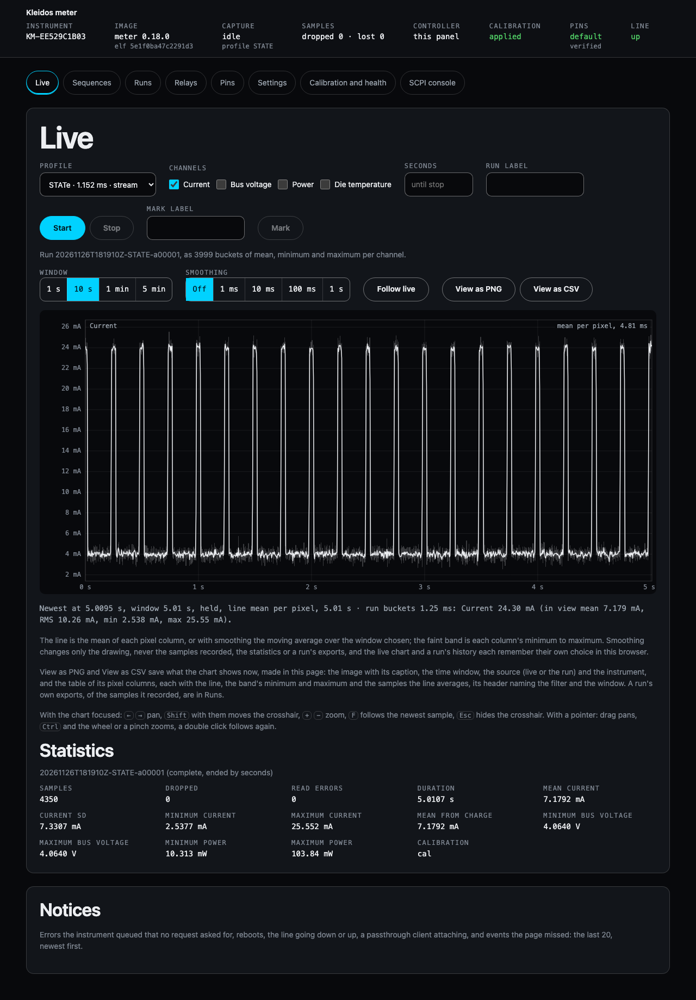

<!-- SPDX-FileCopyrightText: 2026 José M. Requena Plens -->
<!-- SPDX-License-Identifier: GPL-3.0-or-later -->

# Using the meter

A measuring session with the bench meter, in the order its tasks come: install the host tool, find the port, check the line, verify the calibration, take the null, measure, capture, export, move the relays, and leave the instrument as it was found. What each SCPI command means in full is in [the protocol](scpi.md), and what each `kleidos-meter` command takes and exits with in [the command line](cli.md); when an answer is not the one shown, [the troubleshooting page](troubleshooting.md) says what it usually means; every document is listed in [the index](README.md).

Two kinds of example are on this page. A command with `--sim` talks to the simulated instrument: run it anywhere, with nothing plugged in. A test runs every one of them and holds the output shown here to what it prints (`host/tests/test_usage_doc.py`). The others were run on the bench on 2026-11-24, instrument `KM-0000000000` on firmware 0.17.0, with a T-Deck asleep on its battery as the board under test (the DUT); the home directory is written `~` in their output. A long answer is one line; scroll it.

## Contents

- [What you need](#what-you-need)
- [Install the host tool](#install-the-host-tool)
- [Find the port](#find-the-port)
- [Check the line](#check-the-line)
- [Verify the calibration](#verify-the-calibration)
- [Take the null](#take-the-null)
- [A first measurement](#a-first-measurement)
- [Is the number good: `q=`, `path=` and `check=`](#is-the-number-good-q-path-and-check)
- [Record a capture](#record-a-capture)
- [What the line carries](#what-the-line-carries)
- [The panel, and its exports](#the-panel-and-its-exports)
- [What a run holds, and where a measurement is filed](#what-a-run-holds-and-where-a-measurement-is-filed)
- [The relays](#the-relays)
- [Leave the instrument as you found it](#leave-the-instrument-as-you-found-it)

## What you need

- The rig as wired: [the schematic](../hardware/README.md), revision D, with the DUT's battery lead through the meter ([the wiring guide](rig-wiring.md)).
- Firmware 0.17.0 or later on the meter ([README](../README.md)). Flashing is not part of a session.
- A USB cable to the carrier's **CH343** port, not the native one ([carrier-board.md §7](carrier-board.md#7-the-two-usb-c-ports-which-to-flash-from-which-to-talk-to)). The meter has no radio: the cable is the only way in.
- A checkout of this repository and Python 3.11 or later, on macOS or Linux. The calibration registry is read from the checkout, so the tool is installed from it.

One program at a time holds the port. `kleidos-meter`, in every form, and the Kleidos QA harness open it exclusively, and the second to come is refused at once, so check that no QA run is using the meter before you start.

## Install the host tool

From the root of the checkout:

```sh
python3 -m venv host/.venv
host/.venv/bin/pip install -e ./host
. host/.venv/bin/activate
```

`-e` matters: it keeps the tool reading the calibration registry of this checkout (`calibration/`). Anything below can be tried on the simulator first:

```console
$ kleidos-meter --sim '*IDN?' 'SYST:ERR:ALL?'
# the instrument rebooted (*ESR? power-on bit set)
KLEIDOS,KLEIDOS-METER,KM-EE529C1B03,0.18.0
0,"No error"
```

Each argument is one program message, and each is answered by one line. The note on stderr, behind a `#`, says the instrument rebooted since it was last asked; the simulator has always just booted. `KM-EE529C1B03` is the simulator's serial, so an answer with it is never a measurement.

A command without `?` answers nothing, so every message here ends in `SYST:ERR:ALL?`, which answers `0,"No error"` or the reason of each refusal. A message that only commands times out, and the tool exits 1.

## Find the port

The meter is the CH343 adapter, USB `1a86:55d3`. Its device name carries the adapter's serial number, which is private bench data: keep it in a variable, and never paste it into an issue, a log or a tracked file. This takes the one CH343 that is plugged in, without printing it:

```sh
export KLEIDOS_METER_PORT="$(python - <<'PY'
from serial.tools.list_ports import comports

ports = [port.device for port in comports() if (port.vid, port.pid) == (0x1A86, 0x55D3)]
print(ports[0] if len(ports) == 1 else "")
PY
)"
test -n "$KLEIDOS_METER_PORT" && echo "one CH343 found" || echo "none, or more than one"
```

Every `kleidos-meter` command reads `KLEIDOS_METER_PORT`; `--port` overrides it. On the Kleidos bench it is set from the bench's own environment file, which no repository tracks. Do not guess from the name: macOS calls the CH343 `cu.usbmodem…`, as it calls the native port of every ESP32-S3 board on the bench.

## Check the line

```console
$ kleidos-meter '*IDN?' 'SYST:ERR:ALL?'
KLEIDOS,KLEIDOS-METER,KM-0000000000,0.17.0
0,"No error"
```

The serial is the name the calibration registry knows the instrument by. A first line `# the instrument rebooted` means any capture it was running is gone, and its settings are the defaults again; the calibration and the nulls are kept in its flash. Then ask for its health:

```console
$ kleidos-meter 'SYST:HEAL?' 'SYST:INF?' 'ROUT:STAT?' '*TST?'
reset=task_wdt uptime_us=5952336289 elf=0f2b6ed8b28068a4 fw=0.17.0 stack_console=5848 stack_sampler=2920 allocs_after_init=0 frees_after_init=0 hold_released=0 errors=0 reset_released=-
model=kleidos-meter fw=0.17.0 chip=ina228 addr=0x40 mfg=0x5449 die=0x228 rev=0x1 shunt_uohm=100116 cal_tag=R100_20261120_HR q=cal relays=1 bypass_part=relay2click serial=KM-0000000000 image=meter elf=0f2b6ed8b28068a4
k1=lead:closed k2=bypass:open k3=spare:unwired k4=spare:unwired path=shunt check=- pads=ok operate_settle_ms=20 release_settle_ms=50 hold_s=- hold_released=0 bypass_part=relay2click
0
```

| Look at | Healthy | Otherwise |
|---|---|---|
| `*TST?` | `0` | the sum of the parts that failed ([scpi.md, "IEEE 488.2 common commands"](scpi.md#ieee-4882-common-commands)) |
| `chip`, `addr` | `ina228`, `0x40` | the INA228 did not come up: check its wiring before anything else |
| `path` | `shunt` | the relays are off the measuring circuit: [put them back](#leave-the-instrument-as-you-found-it) |
| `errors` | `0` | read them with `SYST:ERR:ALL?`; `113` to `115` say a hold put the relays back, `116` that a reset released them |
| `allocs_after_init`, `frees_after_init` | `0`, `0` | not a healthy image: report it |
| `elf` | the build you expect | another image: the panel's health view compares it with the local build |
| `reset` | `poweron` | `panic`, `brownout` or a watchdog you did not ask for (here `task_wdt`: the bench suite's watchdog test had run last) is worth a report |

## Verify the calibration

The calibration is the registry in this repository ([calibration/README.md](../calibration/README.md)); what the instrument holds is a working copy.

```console
$ kleidos-meter calibration verify
KM-0000000000: applied
  calibration 2026-11-20-02 (mjkdz-r100-relay2click), valid 2026-11-20 to 2027-11-20: range 0 100.116000 mΩ (u 424 ppm), range 1 100.116000 mΩ (u 424 ppm)
```

`applied`, exit status 0, is the only answer to measure on. `working_copy_lost` (a full flash erase, or the first boot of the image that brought the calibration log) and `working_copy_differs` are put right by writing the registry's copy back, which changes nothing when it is already there:

```console
$ kleidos-meter calibration restore --yes
KM-0000000000: applied
  calibration 2026-11-20-02 (mjkdz-r100-relay2click), valid 2026-11-20 to 2027-11-20: range 0 100.116000 mΩ (u 424 ppm), range 1 100.116000 mΩ (u 424 ppm)
Nothing to restore: the working copy is the registry's.
```

Without `--yes` it asks first. The other statuses (`expired`, `configuration_mismatch`, `unregistered`) are not for a restore: [calibration/README.md, "The working copy"](../calibration/README.md#the-working-copy).

## Take the null

At 0.100 Ω, 10 µA is 1 µV, so the offset has to be measured and subtracted. A null is taken with no current in the shunt, on the range it will serve, at the start of every session: it drifts with temperature over hours. The relays do it without hands. `ROUTe:NULLpath ON` closes the bypass (K2) and then opens the lead (K1), so the DUT keeps running around the shunt:

```console
$ kleidos-meter 'SENS:PROF SLE;:SYST:ERR:ALL?' 'SENS:CURR:RANG:IND 0;:SYST:ERR:ALL?'
0,"No error"
0,"No error"
$ kleidos-meter 'ROUT:NULL ON;:ROUT:RES?;:SYST:ERR:ALL?'
k1=lead:open k2=bypass:closed k3=spare:unwired k4=spare:unwired path=bypass check=unverified moved=k2,k1 settle_us=71987 live=0 marked=0 vs_pv=3750000,312500,312500 hold_s=120 q=invalid;0,"No error"
$ kleidos-meter 'CAL:ZERO 60;:SYST:ERR:ALL?'
0,"No error"
$ sleep 61
$ kleidos-meter 'ABOR;:CAL:ZERO:RES?;:SYST:ERR:ALL?'
running=0 range=0 offset_pv=-237190 sd_pv=269062 over_s=60 die_mc=21953 n=888 k1=lead:open k2=bypass:closed k3=spare:unwired k4=spare:unwired path=bypass check=unverified stored=1;0,"No error"
$ kleidos-meter 'ROUT:NULL OFF;:ROUT:RES?;:SYST:ERR:ALL?'
k1=lead:closed k2=bypass:open k3=spare:unwired k4=spare:unwired path=shunt check=- moved=k1,k2 settle_us=61107 live=0 marked=0 vs_pv=- hold_s=- q=cal;0,"No error"
```

Read `stored=1` in the result and `path=shunt` after the last message. `n=888` is the window's samples, at `SLEEP`'s 67.52 ms; `ABORt` sent before the seconds are out closes the window early. `check=unverified` is what a DUT that draws under 2 mA gives ([below](#is-the-number-good-q-path-and-check)). Range 1 has a null of its own: repeat with `SENS:CURR:RANG:IND 1` if you will use it. If the session ends between `ON` and `OFF`, the instrument puts the relays back by itself after 120 s (`hold_s`).

The whole sequence is one button, `NULL_RELAY`, on [the panel](#the-panel-and-its-exports). The three ways to take a null, and which is normative, are in [calibration/README.md](../calibration/README.md#the-null-before-every-measurement-session).

## A first measurement

`MEASure` takes 100 samples on the current profile and answers their mean, in amperes, volts or watts:

```console
$ kleidos-meter 'SENS:PROF STAT;:SYST:ERR:ALL?' 'MEAS:CURR?;:SYST:ERR:ALL?' 'MEAS:VOLT?;:SYST:ERR:ALL?' 'MEAS:POW?;:SYST:ERR:ALL?' 'FETC:STAT?'
0,"No error"
0.00004447603;0,"No error"
4.10993463;0,"No error"
0.00018453;0,"No error"
samples=100 dropped=0 read_err=0 pace_fallback=0 pace_err_ppm=96 pace_unmet=0 dur_us=114907 mean_na=45006.640 min_na=5490 max_na=96010 die_mc_end=22601 flags=0xC003 charge_raw_start=69318 charge_raw_end=69320 osc_tol_ppm=10000 q=cal stale_edges=0 sd_na=18347.466 max_n=3 max_t_us=5544011167 vmin_uv=4090031 vmax_uv=4122069 pmin_uw=22 pmax_uw=394 mean_charge_na=49513.746 charge_us=126066 thr_na=- above_n=- above_us=- rises=- batches=50 batch_samples=2 trig_n=- trig_t_us=- thr_marks=0 rebased=0 hold_teardowns=0
```

The sleeping board draws about 45 µA at 4.11 V. Each `MEASure` is an acquisition of its own, and `FETCh:STatistics?` describes the last one. The sign is the DUT's: positive leaves the cell, negative charges it. A single `STATE` sample has about 20 µA of noise (`sd_na=18347`), so the mean of 100 is good to about 2 µA here: choose the profile by what you are looking for.

| Profile | For | A sample every | Where the samples go |
|---|---|---|---|
| `STATE` | a level, a state, anything awake | 1.152 ms | the stream |
| `SLEEP` | deep sleep, microamps | 67.52 ms | the stream |
| `TRACE` | the shape of an event | 280 µs | the ring, 293.6 s of it |
| `BURST` | the sharpest transient | 100 µs | the ring, 104.9 s of it; needs a 1 MHz bus |

Range 0 (the default) measures to 1.6384 A, range 1 to 0.4096 A (`SENSe:CURRent:RANGe:INDex`). Look at events on `TRACE` and `BURST` and take levels on `STATE` and `SLEEP`: `BURST` reads an offset of its own, so a null taken on another profile does not apply to it, whatever its `q=` says. Why there are four profiles is in [architecture.md §3.2](architecture.md#32-the-four-profiles).

## Is the number good: `q=`, `path=` and `check=`

Every report carries these three. A figure is worth keeping when `q=cal` and `path=shunt`.

**`q=`**, how far to trust the reading:

| `q=` | Means | Do |
|---|---|---|
| `cal` | nulled on this range, shunt calibrated, the die within ±5 °C of the null | measure |
| `stale` | the die has moved more than ±5 °C since the null | take the null again |
| `uncal` | this range has no null, or the shunt no calibration | take the null; `calibration verify` |
| `invalid` | the shunt was off the DUT's current at some moment of the window, or the INA228's arithmetic overflowed | throw the capture away |

`q=` in the header speaks for the start of a capture and `q=` in the statistics for all of it: it is the second that decides. `q=invalid` while the null path is on is not a fault: the shunt carries nothing then.

**`path=`**, the circuit the relays make:

| `path=` | Lead (K1) | Bypass (K2) | The shunt carries | A capture there |
|---|---|---|---|---|
| `shunt` | closed | open | all of the DUT's current | measures |
| `bypass` | open | closed | nothing, with the DUT running | is refused (`101`); it is where a null is taken |
| `both` | closed | closed | a part of it | is refused (`101`), and so is a null |
| `none` | open | open | nothing: the DUT has no battery | reads the zero it draws |

**`check=`**, what `ROUTe:NULLpath ON` saw the contacts do, since no relay reports where it is:

| `check=` | Means |
|---|---|
| `ok` | both moves were seen in the shunt: the null is taken on an open lead |
| `unverified` | the DUT drew under 2 mA, too little to see the moves; the order was carried out, and the shunt reads under 50 µV. Take the null with the DUT awake when you can |
| `skipped` | a `LIVE` order under a capture, which reads nothing |
| `-` | any other order |

A contact that was seen not to move is not a `check=` at all: the order is refused with `103` (the bypass took no current) or `104` (the lead stayed closed), and the relays are back on the shunt. A null that reads beyond 50 µV with the lead commanded open is not stored (`102`).

Two more tokens say whether the samples themselves are whole: `dropped=0` (none was lost on the line) and `read_err=0` (none on the I²C bus). `pace_fallback=1` says the conversion-ready pin stopped pacing the capture and the timer took over.

## Record a capture

`kleidos-meter capture` records one capture into a directory of its own, a run, and writes back the settings it changed:

```console
$ kleidos-meter capture --profile STATE --seconds 10 --channels CURR,VOLT,POW --label first
capture: recording ~/.local/state/kleidos-meter/runs/20261124T040405Z-STATE-85d6c4
capture: wrote back profile TRACE (it was STATE)
capture: wrote back channels "" (it was "CURR","VOLT","POW")
capture: run 20261124T040405Z-STATE-85d6c4, ended by seconds, samples=8749 dropped=0, stream=8749 marks=0, complete
$ kleidos-meter capture --profile SLEEP --seconds 30 --channels CURR,VOLT
capture: recording ~/.local/state/kleidos-meter/runs/20261124T040416Z-SLEEP-5a9207
capture: wrote back profile TRACE (it was SLEEP)
capture: wrote back channels "" (it was "CURR","VOLT")
capture: run 20261124T040416Z-SLEEP-5a9207, ended by seconds, samples=444 dropped=0, stream=444 marks=0, complete
$ kleidos-meter capture --profile TRACE --seconds 5
capture: recording ~/.local/state/kleidos-meter/runs/20261124T040448Z-TRACE-754842
capture: run 20261124T040448Z-TRACE-754842, ended by seconds, samples=18096 dropped=0, stream=0 marks=0, trace=18096, complete
```

There are two sinks, and the profile chooses:

- **The stream** (`STATE`, `SLEEP`): each sample is a line on the port as it is taken, for as long as you like, on the channels you choose (`CURR`, `VOLT`, `POW`, `TEMP`). `--seconds` is needed.
- **The ring** (`TRACE`, `BURST`): the samples go into the instrument's memory, current only, 1,048,576 of them, and are read out when the capture ends. Without `--seconds` it runs until the ring is full. The dump is held to its CRC-32 and asked for again when the line damaged it.

`complete`, exit status 0, means every sample the instrument delivered is in the run. `INCOMPLETE` and exit status 1 mean it is not: do not use it. Ctrl-C ends a capture early and still finishes the run. Runs go to `$XDG_STATE_HOME/kleidos-meter/runs` (`~/.local/state` by default) or wherever `--out` says, never inside a git work tree.

The same on the simulator, to try it:

```sh
kleidos-meter capture --sim --profile STATE --seconds 1 --out ~/meter-runs
kleidos-meter capture --sim --profile TRACE --seconds 1 --out ~/meter-runs
```

`BURST` needs the faster I²C clock, which no capture sets for you. Without it the capture is refused, and a refused capture leaves the profile it wrote, so select yours again:

```console
$ kleidos-meter capture --profile BURST --seconds 2
# the capture was refused: the instrument did not start the capture
# -221,"Settings conflict;BURST needs a faster bus (a 100 us period needs a read under 50 us; it is 95 us at 400000 Hz)"
$ kleidos-meter 'SYST:COMM:I2C:FREQ 1000000;:SYST:ERR:ALL?'
0,"No error"
$ kleidos-meter capture --profile BURST --seconds 2
capture: recording ~/.local/state/kleidos-meter/runs/20261124T040457Z-BURST-cf7a25
capture: run 20261124T040457Z-BURST-cf7a25, ended by seconds, samples=20670 dropped=0, stream=0 marks=0, trace=20670, complete
$ kleidos-meter 'SYST:COMM:I2C:FREQ 400000;:SYST:COMM:I2C:FREQ?;:SYST:ERR:ALL?'
400000;0,"No error"
```

A capture by hand is the same commands the tool sends: `INITiate` starts it, `TRACe:MARK` marks a moment, `ABORt` ends it, and `FETCh:STatistics?` gives its figures. The samples that arrive meanwhile are printed behind a `#`:

```console
$ kleidos-meter --sim 'SENS:PROF STAT;:SENS:FUNC:ON "CURR","VOLT";:SYST:ERR:ALL?' 'INIT;:SYST:ERR:ALL?' 'TRAC:MARK "wake";:SYST:ERR:ALL?' 'ABOR;:FETC:STAT?;:SYST:ERR:ALL?'
# the instrument rebooted (*ESR? power-on bit set)
0,"No error"
0,"No error"
# 1000000 {'i_ua': 88600.0, 'v_mv': 4064.0}
# 1001152 {'i_ua': 88600.0, 'v_mv': 4064.0}
# 1002304 {'i_ua': 88600.0, 'v_mv': 4064.0}
# 1003456 {'i_ua': 88600.0, 'v_mv': 4064.0}
0,"No error"
# 1004608 {'i_ua': 88600.0, 'v_mv': 4064.0}
# 1005760 {'i_ua': 88600.0, 'v_mv': 4064.0}
# 1006912 {'i_ua': 88600.0, 'v_mv': 4064.0}
# 1008064 {'i_ua': 88600.0, 'v_mv': 4064.0}
# 1009216 {'i_ua': 88600.0, 'v_mv': 4064.0}
# 1010368 {'i_ua': 88600.0, 'v_mv': 4064.0}
samples=10 dropped=0 read_err=0 pace_fallback=0 pace_err_ppm=0 pace_unmet=0 dur_us=11520 mean_na=88600000.000 min_na=88600000.000 max_na=88600000.000 die_mc_end=25500 flags=0xC003 charge_raw_start=0 charge_raw_end=582 osc_tol_ppm=10000 q=cal stale_edges=0 sd_na=0.000 max_n=0 max_t_us=1001152 vmin_uv=4064000 vmax_uv=4064000 pmin_uw=360070 pmax_uw=360070 mean_charge_na=88600000.000 charge_us=20520 thr_na=- above_n=- above_us=- rises=- batches=10 batch_samples=1 trig_n=- trig_t_us=- thr_marks=0 rebased=0 hold_teardowns=0;0,"No error"
```

## What the line carries

The stream is bounded by construction, so no choice of channels can lose samples to the line's rate: every channel at once on `STATE`, the fastest streaming profile, needs 167 kB/s of the 480 kB/s that 80 % of the 6 Mbit/s line carries. That 80 % line used to be a refusal at `INITiate` (`-221`, `stream too fast`). From 0.17.0 it is checked when the firmware is built, because no profile can reach it, and the instrument refuses nothing for its byte rate. What remains at run time:

- **A ring profile is not streamed.** A finer period goes to the ring, whose size is the limit.
- **`dropped=`** counts the samples the console could not write in time. A run is `complete` when it holds every sample that was delivered, so read `dropped=` as well: anything but 0 is a record with holes, to be taken again.
- **The line has no flow control.** A long ring dump now and then arrives damaged. `kleidos-meter capture` and the panel check its CRC-32 and ask again; a client of your own must too ([testing.md](testing.md)).

## The panel, and its exports

`kleidos-meter serve` holds the port and serves a panel on this computer, with live charts, one button per measurement sequence, the relays, the pin map, the settings and the runs:



```console
$ kleidos-meter serve
serve: KM-0000000000, firmware 0.17.0, image meter, elf 0f2b6ed8b28068a4, q=cal
serve: reset task_wdt, up 6009.6 s
serve: panel at http://127.0.0.1:8040/
serve: panel API at http://127.0.0.1:8040/api/
serve: recordings in ~/.local/state/kleidos-meter/runs
serve: holding the port; stop with Ctrl-C
serve: released the port
```

The last line is Ctrl-C, with exit status 0. While it runs nothing else opens the meter, the QA harness included: stop it before a QA run. A tool that finds the port held says so (the message names the port, so do not paste it), and `capture` and `serve` name the holder:

```console
$ kleidos-meter capture --profile STATE --seconds 10
# the port is held by kleidos-meter serve (pid 19555, since 2026-11-24T05:05:02+01:00, panel http://127.0.0.1:8040/)
```

To look at the panel with no instrument:

```sh
kleidos-meter serve --sim        # Ctrl-C stops it
```

Its Runs view lists the runs in the data directory, those `kleidos-meter capture` took included, and downloads each as `text`, `csv` or `json`. From a shell:

```sh
curl -s http://127.0.0.1:8040/api/runs
curl -sOJ "http://127.0.0.1:8040/api/runs/20261124T040405Z-STATE-85d6c4/export?format=csv"
```

| Format | Holds |
|---|---|
| `text` | the stream as the instrument writes it, `METER t=<us> ch=<channel> v=<value>` and the marks |
| `csv` | one row a sample, `S,<t_us>,<i_ua>,<v_mv>,<p_mw>,<die_c>`, and one a mark, `K,<index>,<t_us>,<label>`; a channel not captured is empty |
| `json` | the run's `meta.json`, its marks and its columns as integers with their units (`t_us`, `i_na`, …) |

A ring run exports the same three, its rows timed from the dump's drift anchors. `text` and `csv` hold the samples alone; keep the run's `meta.json` beside them, or use `json`. The panel's views, its sequences, the SCPI passthrough and what happens when something dies are [panel.md](panel.md), and its API [http-api.md](http-api.md).

## What a run holds, and where a measurement is filed

A run needs no other document to be read:

| File | Holds |
|---|---|
| `stream.txt` | the instrument's stream records, byte for byte; empty but for the marks in a ring run |
| `trace.raw` | a ring run's dump, written once its CRC-32 matched |
| `meta.json` | the instrument and its image, every setting at the start, the capture's header and statistics as the instrument wrote them, what the files hold with their SHA-256, the errors queued meanwhile, how it ended and whether it is `complete` |

The header and the statistics are what make it self-describing: the shunt and the null the samples were converted with (`shunt_uohm`, `offset_pv`), the profile's period and what paced it, the range, the calibration tag, the circuit (`path=`, `check=`) and the quality (`q=`). Timestamps are microseconds since the instrument booted; the only wall clock in a run is the host's, and is labeled so. A capture taken by hand has those facts only if you ask for them and keep them: `FETCh:HEADer?` after `INITiate`, `FETCh:STatistics?` after `ABORt`.

**A run is a working file, not a measurement of record.** It is never committed: not here, and not in the firmware repository. A figure that will be quoted, in a document, a `variant.h` or the site, is measured with the Kleidos firmware repository's QA harness (`qa/tools/power_campaign.py`), which brackets each capture with its own nulls, states it at the registry's calibration at a pinned commit (`qa/meter-registry.lock.json`) with its uncertainty, and files it in that repository's power store (`qa/measurements/power/`). Use this tool to look, to prepare and to find out what is wrong.

## The relays

K1 is the DUT's battery lead and K2 the bypass across the shunt and K1. Off is the measuring circuit, and it is what a boot, a reset or a dead meter leaves. Prefer `ROUTe:NULLpath ON` and `OFF`, which move both in the order that never leaves the DUT without a supply. The orders that can hurt say so, and are refused until you mean it:

```console
$ kleidos-meter --sim 'ROUT:LEAD OPEN;:SYST:ERR:ALL?' 'ROUT:NULL ON;:SYST:ERR:ALL?' 'INIT;:SYST:ERR:ALL?' 'ROUT:NULL OFF;:SYST:ERR:ALL?'
# the instrument rebooted (*ESR? power-on bit set)
109,"Order disconnects the DUT;order disconnects the dut (k1 open, k2 open: add FORCe)"
0,"No error"
101,"Shunt bypassed;shunt bypassed (path=bypass: ROUTe:NULLpath OFF, or INITiate:FORCe)"
0,"No error"
```

- **`FORCe`** is for an order that leaves the DUT with no supply (`109`) or takes the shunt off a running capture's current (`110`, and the capture becomes `q=invalid`).
- **`LIVE`** is for any move while a capture runs (`-221` without it); each move is marked in the capture. Nothing moves under a null window (`112`).
- **A cold boot** is `ROUTe:LEAD:CYCLe <ms>,FORCe`: K1 opens, and the instrument recloses it `<ms>` later by itself. The DUT is off only if its USB port is cut as well.

```console
$ kleidos-meter --sim 'ROUT:LEAD:CYCL 2000,FORC;:SYST:ERR:ALL?' 'ROUT:RES?' 'ROUT:LEAD CLOS;:ROUT:RES?;:SYST:ERR:ALL?'
# the instrument rebooted (*ESR? power-on bit set)
0,"No error"
k1=lead:open k2=bypass:open k3=spare:unwired k4=spare:unwired path=none check=- moved=k1 settle_us=20000 live=0 marked=0 vs_pv=- hold_s=120 q=cal
k1=lead:closed k2=bypass:open k3=spare:unwired k4=spare:unwired path=shunt check=- moved=k1 settle_us=50000 live=0 marked=0 vs_pv=- hold_s=- q=cal;0,"No error"
```

`ROUTe:RESult?` describes the order that has run: `path=none` while the lead is open, and the 120 s the hold still gives it (`hold_s=120`). An explicit `ROUT:LEAD CLOS` ends the cycle early. Whatever path is left other than `shunt`, the hold puts the relays back after 120 s and queues `113`, `114` or `115` to say so; any relay order starts the 120 s again. The interlocks in full are in [scpi.md, "ROUTe: the relay module"](scpi.md#route-the-relay-module), and how long the contacts take in [relay-timing.md](relay-timing.md).

## Leave the instrument as you found it

`*RST` closes any window without storing it, puts the relays back on the shunt and every setting at its default. It does not touch the calibration or the nulls:

```console
$ kleidos-meter '*RST;:SYST:ERR:ALL?' 'ROUT:STAT?' 'SYST:STAT?' 'FORM?' 'SENS:CURR:RANG:IND?' 'SYST:COMM:I2C:FREQ?' 'SYST:ERR:ALL?'
0,"No error"
k1=lead:closed k2=bypass:open k3=spare:unwired k4=spare:unwired path=shunt check=- pads=ok operate_settle_ms=20 release_settle_ms=50 hold_s=- hold_released=0 bypass_part=relay2click
running=0 sink=idle profile=TRACE period_us=0 pace=timer pace_fallback=0 range=0 samples=20670 dropped=0 read_err=0 i_na=8611 vbus_uv=4111523 die_mc=22937 die_age_us=3860890 flags=0xC003 scl_hz=400000 q=cal trig=-
TEXT
0
400000
0,"No error"
$ kleidos-meter calibration verify
KM-0000000000: applied
  calibration 2026-11-20-02 (mjkdz-r100-relay2click), valid 2026-11-20 to 2027-11-20: range 0 100.116000 mΩ (u 424 ppm), range 1 100.116000 mΩ (u 424 ppm)
```

The end state the next person counts on: no window open (`running=0 sink=idle`), `path=shunt`, range 0, 400 kHz, `TEXT`, an empty error queue, `calibration verify` at `applied`, and the port released: no `kleidos-meter serve` left running.
